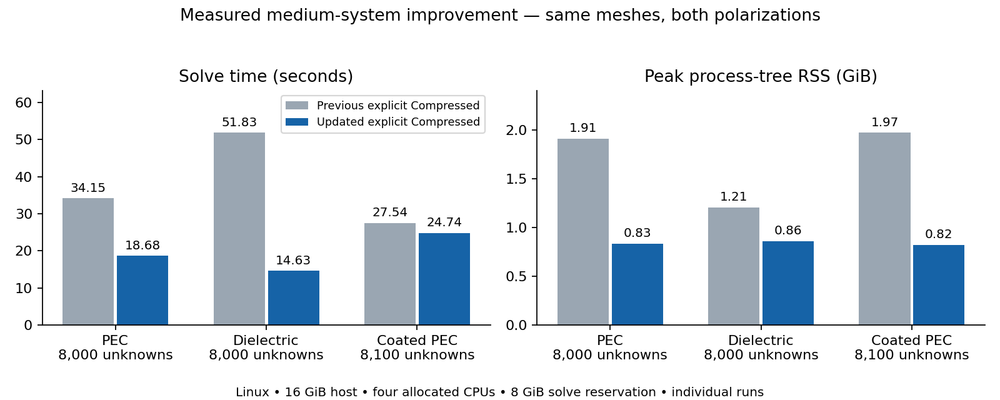

# Backend stress improvements — implementation and investigation handoff for Claude

Date: 2026-11-12. Target branch: `codex/backend-stress-improvements-2026-11-12`.
Parent: `bfcd255e76b12fc5ed13b44b1e276c4b7472a5ce` (`codex/backend-stress-suite-2026-11-12`). Production baseline: `ae08d66dc309c393ce62cc76bacd510a150ebf33`.

This branch implements three improvements supported by the previous 157-case stress study. It preserves the previous handoff and its evidence at [backend-stress-suite/HANDOFF_BACKEND_STRESS_SUITE.md](../backend-stress-suite/HANDOFF_BACKEND_STRESS_SUITE.md). This report supersedes that report's statements about the *current* hierarchical threshold and dielectric/polarization memory planning; its historical measurements remain unchanged.

## Production changes

1. **Use hierarchical compressed assembly from 1,024 unknowns for explicit Compressed as well as Automatic.** The old explicit threshold was 8,192. Remove the now-redundant outer retry that previously repeated an explicit compressed request after tile inverse rejection. Unsupported configurations, small systems, and internally rejected hierarchical assembly still have their tile paths. Explicit threshold overrides and zero-to-disable remain honored. Automatic's admitted backend retry remains intact and has a direct failure/retry/evidence regression test.
2. **Correct single-dielectric Dense assembly ownership.** With equal observation/source quadrature rules, operators scatter directly into the final `2n × 2n` system. The old plan also charged a separate `n × n` single-layer matrix. A helper shared with actual assembly now describes that ownership. Unequal rules retain the real extra matrix and allowance. Name-only/unqualified estimates remain conservative. This corrects admission; it does not claim to remove an allocation that still existed. Generic workspace allowances, residual-spool policy and remote two-matrix forecasts remain intact.
3. **Make compressed polarization planning self-consistent.** Price fixed paired and separate candidates. Each candidate's automatic payload allowance subtracts the workspace for that same candidate. The separate candidate cannot silently become paired because its smaller workspace leaves a larger payload remainder. The paired payload-fit check now includes both operators and the inverse. Explicit payload caps are preserved. Submission forecasts keep conservative workspace accounting; live allocation/admission checks remain active.

No GUI controls, material models, polynomial defaults, convergence tolerances, residual limits or condition limits are changed. Some medium explicit Compressed requests now use a different representation and need not be bitwise identical to the old tiled path. Dense may now accept a qualified dielectric request that was previously refused solely by the extra matrix allowance. Automatic can consequently select Dense in a budget where the old plan excluded it. All eight `.dll`/`.so` files are byte-for-byte unchanged; Windows execution was not performed in this Linux environment.

## Validation results

**143 declared case results:** 129 production qualification cases (19 memory rejection, 110 success) and 14 explicitly marked research/diagnostic cases (1 memory rejection, 2 solver rejection, 11 success). No result from the interrupted measurement is counted.

The original **102-case baseline replay produced 84 successes and 18 admission refusals**. All 83 previously successful baseline cases still succeed. The one outcome improvement is `pressure-2.0-dense`: previously refused, now completed at 15.76 s / 1.106 GiB. No production numerical gate was weakened.

- **15 targeted regression groups passed**, including actual P1/P2/P3 equal/unequal-rule allocation routes, remote conservatism, storage-cap preservation, independent concurrent plans, the pairing/remainder counterexample, and Automatic failure/retry evidence.
- **113 recorded legacy checks/workflow results passed** across six scripts: plans (22), residual safety (17), bounded spool (9), workflows (5), alternate paths (3), and cap resolution/concurrency (57). The workflow checks include certified/adaptive and polynomial solves, fresh frequency workers, disk/memory comparisons and BoR shared spool behavior.
- **9 full native-disabled solves passed**, including PEC, dielectric and coating H-matrix cases above 1,024 unknowns. Each records actual fallback calls and zero child processes, so the in-process overrides really apply. Worst native-enabled/disabled complete-field difference: 1.6595e-11. Magnetic-contrast Thin Layer and an injected H-matrix assembly rejection both complete through their retained tile paths.
- **83 old/new complete-field comparisons**, 3154 complex samples, worst normalized maximum difference **3.4480e-09**. The same-mesh Dense/compressed comparisons total **48**, worst **1.4365e-08**. The denominator is the peak magnitude of the reference field vector, avoiding divisions by scattering nulls.
- **184 independent cylinder-series polarization checks**, all finite; largest RCS error **0.04689 dB**. These polygon-versus-circle errors are separate from backend agreement. All **8** requested baseline certified solves certify.

Representative updated explicit Compressed results, compared with the previous baseline:

| Case | Previous seconds / tree GiB | Updated seconds / tree GiB |
|---|---:|---:|
| PEC, 8,000 unknowns | 34.15 / 1.910 | 18.68 s / 0.834 GiB |
| Dielectric, 8,000 unknowns | 51.83 / 1.206 | 14.63 s / 0.859 GiB |
| Coated PEC, 8,100 unknowns | 27.54 / 1.970 | 24.74 s / 0.821 GiB |



The Dense ownership-only qualifications complete at **15.76 s / 1.093 GiB with a 1.8 GiB reservation** and **83.97 s / 4.010 GiB with a 4.8 GiB reservation**. The 16,000-unknown constrained run is bitwise equal across all 38 fields to its explicit tile-128, unconstrained reference. Requesting in-memory residual storage at 1.8 GiB still correctly refuses the 8,000-unknown system (2.22 GiB forecast).

Automatic successfully selects compressed at 1.8 GiB and at 2.3 GiB with automatic residual storage. Its existing 20% headroom rule still applies; at 2.3 GiB automatic storage prices the in-memory Dense route (2.22 GiB), which falls outside that headroom. With disk storage explicitly requested at 2.3 GiB, it prices Dense at 1.766 GiB, selects Dense and succeeds. No margin or storage-policy default changed. Explicit Dense has its own existing admission behavior.

Times are individual sequential fresh-process observations, not a statistical guarantee. Peaks are sampled process-tree RSS; shared pages can be counted more than once. Parent high-water RSS, full timelines and inclusive stage timings are also retained. Windows execution and general 3-D models are not qualified by these Linux 2-D tests.

An environment restart interrupted one additional 16,000-unknown measurement after its benchmark watchdog exited. The orphaned owned solve was stopped, its partial evidence was preserved under `interrupted_run/`, and that case was rerun from scratch. The partial attempt is excluded from timing and completion counts. One successful native-disabled PEC run was also repeated because its original monitor saw an unidentified transient child during startup; the original is retained in `fallback_verification_repeat/`, while the final verified run supplies the reported measurement.

Source provenance: the first 33 explicit Dense/Compressed control/scaling runs preceded a correction to Automatic retry timing (`attempt_start` initialization). Their digest is `dc37e91c015799885dd0d1529ffbe5770147ee3381b100726ba34659ab7ffbe2`. The final production digest is `7d234aff23e53ac0e4bdedf2732cf43875a6e7189222cc0d82159fb9f5a3da63`. `verify_source.py` reconstructs the early digest by removing that one timing assignment; the explicit numerical paths are identical. All subsequent solves, the real Automatic qualification and the injected Automatic retry regression use the final code. No numerical fix was made during the replay. `SOURCE_BASE_VERIFICATION.json` independently matches all 269 unchanged GHOST files against the GitHub parent tree and identifies exactly seven changed code/documentation files.

## What remains from the previous handoff

- Keep Dense and compressed internally, with Automatic as the single user-facing selection policy. Dense remains useful for small/medium fast solves and independent field comparisons. Compressed extends capacity at large electrical size; its rank/workspace growth still matters. These changes do not establish a universal 20-foot dielectric solver for a 32 GiB desktop.
- Disk-backed Dense residual storage is an existing useful memory policy. Automatic storage already chooses it when required by the reservation. Forcing disk globally would trade speed for RAM even when RAM is available; the previous measured PEC case slowed from 20.08 to 29.24 seconds. No new global disk default is introduced.
- A single dense complex128 matrix for the 20-foot 10 GHz dielectric example is about 39 GiB. Correcting bookkeeping does not remove that physical matrix floor or make the LU out-of-core. Compressed is still needed for such examples on 32 GiB.
- The test machine has a 16 GiB cgroup and four allocated CPUs. Live tests normally reserve 8 GiB and have an independent 10 GiB process-tree RSS watchdog. The 32 GiB desktop discussion uses an offline illustrative 24 GiB solve reservation and adequate scratch. Neither value is a new application limit.
- One-shot quality gates certify the discrete linear solve, not mesh convergence. Full-field agreement and smooth-cylinder series checks supplement those gates. Difficult layered/corner models still need a mesh accuracy study.

## Further investigations and decisions

### Dense workspace: retain the conservative bound

The ownership correction is directly tied to the actual allocation route and is validated with unequal-rule and polynomial controls. The broader tile/near-workspace prototype remains research-only. The retained generic formula is `(64 + 128*threads) MiB + 8192*nodes`, separate from owned operators and cached work.

Inspection identifies why replacing this with one tile times one worker is insufficient: `_run_dependent_tiles` permits three uncommitted tiles per worker; parked output buffers coexist with active kernel scratch. Near integration streams batches of 8,192 pairs through a 16 MiB store, but geometry/index/sort metadata remain live. Adaptive near quadrature has a separate one-million-sample bound and scatter copies; basis order and native/fallback routes alter the live arrays. The prior proposed tighter coefficients are not a proven common bound over all these paths.

A worthwhile next change is to make those routines expose their actual bounded output/scratch dimensions, and then derive the planner allowance from the same definitions. Qualification must include stalled commits, close nonadjacent panels, P1/P2/P3, native-disabled kernels, cancellation and Windows. Do not ship a scalar measured/predicted discount. The ownership-only low-budget solves above demonstrate how much benefit is already available without that uncertainty.

### Closed coating conditioning

The existing block Sinkhorn condition normalization is restricted to union-closed junctions. The audit hook extends it to closed coating density blocks without changing the assembled equations, fields, or gate thresholds. On the 5,951-unknown coated star, Dense's condition estimate changes from **533,085.6 to 26,686.6**, with **bitwise-identical fields**. The small coated circle changes from 1,044.3 to 230.5, also with identical Dense fields. Four independent synthetic near-null/scaling controls confirm the norm calculation and retain large conditions for deliberately near-singular matrices; these are algebra checks, not physical-model certification.

The full **20-foot thin-coated star at 2 GHz, 18,253 unknowns**, reveals two distinct limitations:

| Diagnostic / research case | Outcome |
|---|---|
| Previous stock Dense and compressed | Refused first polarization at condition about 2.50349e6, above 1e6 |
| Block condition scaling, compressed | Both polarizations pass; **125.10 s / 2.538 GiB**, maximum condition about 69,983 |
| Block condition scaling, Dense | First polarization passes (condition 69,982.85); second fails original-matrix normwise backward error **6.8608124e-6**, above 1e-12 |
| Original unbalanced Dense, TM-only diagnostic | Independently reproduces **exactly the same backward-error failure**; excludes polarization reuse and the block-scaling hook as causes |
| Block condition scaling plus two-sided max-equilibrated Dense LU | Both polarizations pass; **208.13 s / 5.280 GiB**, maximum condition about 69,983 |

The last Dense solve agrees with the successful compressed research solve across **all 38 complex fields to 4.1413e-9** relative to the peak field. Maximum relative residual is 6.6873e-11. Its original matrix remains the residual reference: the research hook scales the LU input and correctly transforms normal, transpose and adjoint inverse actions. It uses bounded existing norm passes and row/column vectors, not another full matrix. Six independent vector/matrix normal/transpose/adjoint checks pass. Scaled-LU small-circle and medium-star controls agree with stock Dense to 1.46e-13 and 3.09e-12, respectively.

**Decision: retain both changes as research, and prioritize them for the next numerical review.** The experiment resolves the observed LU failure, but does not certify mesh convergence or the continuum fields of this very thin, full-size shape. A condition number depends on scaling, so turning a condition gate green alone is not a sufficient fix. This is a real additional improvement opportunity, not evidence that every previous condition refusal was spurious. Production still uses its original condition diagnostic and LU path, and refuses this stock example.

For production implementation, use per-factor owned scaling vectors and correctly transformed inverse/adjoint actions; do not ship the audit's process-global SciPy monkeypatch. Qualify independent base/fine mesh fields, thin-gap and junction extremes, both disk/memory storage paths, cancellation/retry cleanup, singular negative controls, and Windows. The full-size example has a nominal 6.096 m extent and roughly 0.64–1.01 mm coating gap; these results do not establish 15/18 GHz capability for that geometry.

### Loss-aware compressed forecasting

The audit-only alternative uses, at each cluster diameter `D`, the maximum over all media of `abs(Re(k))*min(D, log(1/tolerance)/abs(Im(k)))`; lossless media retain the full span. It preserves the lossless exterior floor, geometry, exact near storage, sample rows and workspace formulas. It changes only predicted ranks; no coefficient or physical interaction is dropped by this hook. This is a hypothesis, not a proven inverse-rank or memory bound.

Matched 8,400-unknown solves all pass unchanged numerical gates:

| Material | Production predicted inverse rank | Research predicted inverse rank | Measured research inverse rank | Production / research peak forecast GiB |
|---|---:|---:|---:|---:|
| lossless | 390 | 390 | 231 | 1.159 / 1.159 |
| moderate-loss | 390 | 390 | 208 | 1.159 / 1.159 |
| high-loss | 452 | 227 | 103 | 1.254 / 1.014 |

The bounded 20-foot 10 GHz dielectric experiment lowers the forecast from 19.03 to **13.81 GiB**, but it is still refused before assembly under the declared **12 GiB research reservation**. The independent 10 GiB RSS watchdog remains in force. This is not a successful large solve or a measured 13.81 GiB memory demand. The available machine has only 16 GiB; no 32 GiB execution is claimed.

**Decision: do not ship this rank discount.** The matched loss tests show why magnitude-only forecasts can overestimate, but do not validate this expression over coatings, resonances, high contrast, multiple bodies, polynomial bases or inverse construction. The lossless outer field still couples distant parts. Bounded actual rank/payload calibration is a better next step than a universal attenuation discount.

### 32 GiB desktop forecast

`FORECAST_32GIB.json` reprices the exact captured meshes at an assumed 24 GiB solve reservation, four CPUs and adequate scratch. For the 20-foot 10 GHz coated model (69,036 unknowns), the predicted peak remains **23.985 GiB**, but the corrected separate plan now allows **18.148 GiB** for its **18.133 GiB** operator-plus-inverse payload. That leaves only about **15 MiB of forecast headroom** at the assumed reservation. Previously it allowed only **15.331 GiB** while reserving unused paired workspace. This repairs an inconsistency; it does not demonstrate that this marginal model finishes on a real desktop.

For the 51,138-unknown 10 GHz single dielectric, the qualified Dense forecast falls from **49.69 to 39.94 GiB**, still above 32 GiB and its illustrative 24 GiB solve reservation. Compressed remains **19.03 GiB** with a predicted inverse rank of 2,235 against the implementation ceiling of 2,048; that is a warning from an empirical model, not a measured rank failure. At 15/18 GHz, the corresponding dielectric/coating compressed forecasts remain about **40.15/51.47** and **56.89/72.82 GiB**. No production loss-based forecast discount is applied.

## Next worthwhile work

| Area | Evidence-supported next step | Limitation to preserve |
|---|---|---|
| Dense | Derive workspace from actual tile queues, near batches and scatter buffers; retain automatic disk-backed residuals | The final matrix and LU remain quadratic/in-memory; estimate improvements cannot remove their floor |
| Compressed | Bounded rank calibration for the actual geometry/media, including inverse construction and live payload accounting | Operator samples alone do not certify inverse rank or peak workspace; keep exact-row/residual checks |
| Very high electrical size | Study directional compression or a matrix-free fast multipole operator with a robust preconditioner as a larger architectural project | Raising the rank ceiling or loosely discounting forecasts is not an equivalent capacity improvement |
| Complex layered geometry | Qualify condition normalization and mesh convergence together; target local curvature/gaps/junctions in refinement | Do not automatically replace PEC-backed layers by the free-standing Thin Layer model, merge physical interfaces or reduce points per wavelength merely to fit RAM |

Geometry extent alone is a poor capacity predictor: total interface length, coincident density count, electrical size, contrast/loss and close interactions all matter. The implemented planner continues using the actual mesh/cluster geometry. These findings support one user-facing Automatic policy with two internal numerical representations.

## Evidence, reproduction and review scope

`RAW_EVIDENCE.tar.xz` contains every run's complete complex samples, metadata, resource/admission events, stdout/stderr, RSS timeline, generated geometry and regression logs. `ARCHIVE_MANIFEST.json` verifies member paths, sizes and SHA-256 values. `SUMMARY.json`, `PREVIOUS_COMPARISON.json`, `FORECAST_32GIB.json`, `SOURCE_IDENTITY.json` and the catalogs are directly browsable. `research_hooks.py` is audit-only and never imported by production. Its flags are present in each affected case specification.

Run the scripts with a Python environment containing NumPy, SciPy, psutil and threadpoolctl and the native libraries already provided by this branch. Use a fresh copy of the audit scripts in an empty output directory because the suite deliberately skips existing results:

```bash
GRIM_ROOT=/path/to/20261028_GRIM
GRIM_AUDIT="$GRIM_ROOT/audits/codex-2026-11-12/backend-stress-improvements"
GRIM_RUN=/tmp/ghost-stress-improvements-reproduction
mkdir -p "$GRIM_RUN/checks"
cp "$GRIM_AUDIT"/*.py "$GRIM_RUN/"
cp "$GRIM_AUDIT/coated10-resources.json" "$GRIM_RUN/"
cp -R "$GRIM_AUDIT/legacy_checks" "$GRIM_RUN/"
python "$GRIM_RUN/suite.py" "$GRIM_ROOT"
python "$GRIM_RUN/investigations.py" "$GRIM_ROOT"
OPENBLAS_NUM_THREADS=1 OMP_NUM_THREADS=1 python "$GRIM_RUN/test_improvements.py" "$GRIM_ROOT"
python "$GRIM_RUN/legacy_checks/run_checks.py" "$GRIM_ROOT"
python "$GRIM_RUN/analyze.py" "$GRIM_ROOT"
python "$GRIM_RUN/validate_outcomes.py"
OPENBLAS_NUM_THREADS=1 python "$GRIM_RUN/research_balance_controls.py" "$GRIM_ROOT"
OPENBLAS_NUM_THREADS=1 python "$GRIM_RUN/research_scaled_lu_controls.py" "$GRIM_ROOT"
python "$GRIM_RUN/forecast32.py" "$GRIM_ROOT"
```

For old/new comparisons, first extract the previous handoff's archive into its own evidence directory, then pass that directory to `compare_previous.py`. Case selections can follow the repository argument to `suite.py` or `investigations.py`; the catalogs give exact names. Do not run heavy cases concurrently. A timeout or admission refusal is an outcome, not an instruction to disable its watchdog or numerical gates.

## Questions for Claude's independent review

1. Does the shared dielectric ownership declaration match every equal/unequal-rule and polynomial allocation route? In particular, verify that no unqualified/private or remote forecast wrongly inherits the direct-scatter discount.
2. Can you construct a paired/separate planning counterexample after freezing the choice, including live-residency adjustments, retained polynomial workers, explicit storage limits and independent simultaneous requests? Reproduce the captured 69,036-unknown coating plan at 24 GiB.
3. Independently exercise the new explicit threshold on Windows and the supported tile fallback cases. Confirm Automatic retry evidence and that no removed outer retry provided a distinct useful attempt now that both modes start at 1,024.
4. For the tighter Dense workspace follow-up, identify actual maximum live arrays for parked commits, active native/fallback tiles and adaptive near batches. A derivation tied to allocation code is needed before replacing the retained conservative workspace formula.
5. Review the closed-coating condition normalization and the independently reproduced Dense TM LU failure. Does a per-factor implementation of two-sided LU equilibration reproduce the successful research result while preserving all original-matrix residual and adjoint-condition semantics? Which physical/mesh-convergence controls are needed before enabling either change?
6. Review the attenuation-span experiment as a forecast hypothesis, especially the lossless exterior floor and inverse-rank risk. Propose bounded sampling/calibration that preserves live construction and numerical acceptance checks; do not generalize one lossy model's measured/predicted ratio to the full 2–18 GHz envelope.

