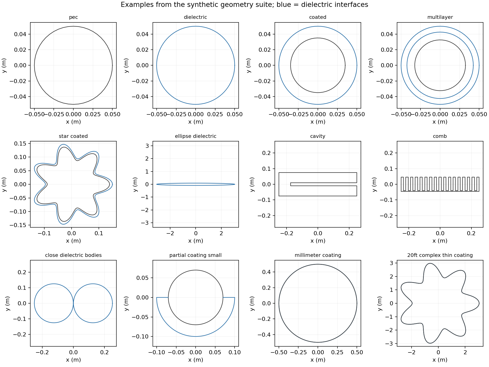
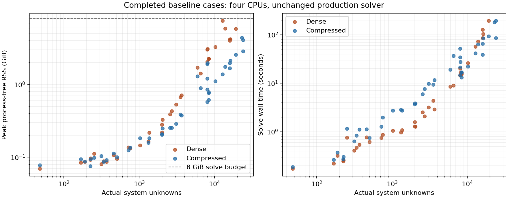

# Dense and compressed backend stress suite — handoff for Claude

Date: 2026-11-12. Production runtime: `ae08d66dc309c393ce62cc76bacd510a150ebf33`. Audit parent: `e95927e6860dbba11738823c279e252a89f7d3db`.

This is an investigation with measured solves and research-only experiments. No production solver, GUI, native library, numerical tolerance, or default option is changed. The runtime Python digest and all eight native binary hashes are in `ENVIRONMENT.json`. All scripts operate on a separately supplied repository checkout. The two research hooks are explicitly named in the case specifications.

## Decision supported by the evidence

Keep Dense and compressed internally. Dense is a useful small/medium-system fast path and an independent numerical comparator. Hierarchical compression materially extends feasible electrical size and reduces RAM; it also has representation-selection overhead, rank growth and geometry-dependent costs. One automatic user-facing solve policy can choose between them. These results do not support removing either implementation or promising that compressed solves every 20-foot dielectric model on 32 GiB.

The strongest near-term opportunities are (1) avoiding the explicit-compressed tile detour, (2) qualifying the tighter Dense workspace estimate and memory-first storage policy, and (3) improving compressed admission estimates using bounded calibration. Changing polynomial order or weakening quality gates is not needed to obtain the measured improvements.

A separate numerical limitation is important for the user's complex layered models: a 20-foot thin-coated star fits in RAM with both methods but both refuse it at the same condition estimate. Improving memory alone does not resolve that case. See the geometry-limit findings below.

## Completed outcomes

**157 declared cases were executed**: 102 baseline cases, 35 initial follow-ups and 20 confirmation/diagnostic cases. The evidence exporter verifies exact catalog coverage and the production Python digest on every recorded run.

- **130 completed solves**, all with passing discrete-system quality gates and finite fields.
- **21 memory-admission refusals** at the declared test reservations. These include the deliberately constrained stock forecast control; none is presented as a measured out-of-memory event.
- **6 condition-gate refusals**, covering three full-size coated-star variants in both methods.
- **No crashes, watchdog memory terminations or timeouts.** The recorded solve calls total about 57.6 minutes, including refused calls.
- **All 10 requested certified cases certified**, covering smooth bodies, an adaptive cavity and partial-coating junctions. Most other cases intentionally use one-shot solving.
- **48 completed Dense/compressed field comparisons**, including all 362 fields of the 181-angle test. The worst normalized maximum complex-field difference was **1.4365e-8**, on the 16,200-unknown coated scaling case. This is the maximum over the entire returned field vector, not a saved prefix.
- **180 polarization/cylinder-series evaluations** across the applicable successful cases; all references were finite. The largest RCS discrepancy was **0.04689 dB** on the small high-permittivity TM case. These polygon-versus-circle errors are distinct from the much smaller backend differences and show why backend agreement alone is insufficient as a mesh accuracy claim.

The final high-frequency complex PEC example also succeeded: a **20-foot seven-lobe body at 15 GHz**, 22,805 unknowns, solved with compressed in **150.60 seconds / 3.73 GiB**, with maximum condition estimate about 5,078. Dense was refused by the **8 GiB test reservation** (8.32 GiB lean forecast). That refusal does not imply Dense would fail on a 32 GiB desktop; the compressed completion demonstrates a practical large-complex-PEC case on the available smaller host.

## Scope, hardware and what the tests mean

- The test environment has **16 GiB**, not 32 GiB, with four CPUs allocated. Most live cases use an **8 GiB solve reservation**; pressure tests deliberately use smaller reservations. This is an explicit test setting, **not a new application default or machine limit**. A separate watchdog terminates a process tree above 10 GiB sampled RSS or its declared deadline. No concurrent benchmark jobs compete for CPU/RAM.
- The desktop capacity section is **an offline forecast**, assuming 32 GiB installed and **24 GiB available to this solve**, with adequate disk-backed scratch. That 24 GiB is an illustrative reservation, not a new application limit. Actual free RAM, other applications, scratch capacity and user settings matter.
- These are **2-D boundary-integral models**, including both TE and TM. A 20-foot circular example means **6.096 m outer diameter**, not a finite 3-D vehicle. For stars, "20-foot" denotes the generator's nominal `2 * maximum radius` size; their Cartesian spans are slightly smaller. Unknown counts scale with total boundary/interface length and basis/material densities, not bounding-box length alone. Slender bodies and extra folded interfaces can differ greatly.
- Most cases are one-shot survey solves on explicitly supplied polygonal meshes, approximately 20 panels per wavelength in the primary material, P1 basis, 19 angles from 0 to 180 degrees. Those 19 angles produce 38 complex fields. Corners may add graded panels; actual counts, not input counts, are reported. Multilayer tests use about 20 samples per wavelength in the outer eps=4 material and about 13.3 in the inner eps=9 material. Fixed-count loss sweeps isolate material effects rather than holding wavelength resolution constant.
- Materials include PEC; eps=4−0.2j dielectric; PEC-backed dielectric; two dielectric layers; lossless, high-loss and high-permittivity variants. Geometries include circles, long thin ellipses, seven-lobe stars, deep cavities, combs, close bodies, very thin resolved coatings and partial coatings with material junctions. Materials are isotropic, nonmagnetic and nondispersive in these runs.
- Explicit Dense and explicit compressed modes are the primary comparison. Automatic dispatch is inspected in source; the timing comparisons are not a benchmark of every Automatic selection decision. BoR, arbitrary 3-D, anisotropy, magnetic contrasts, frequency-dispersive CSVs, Windows execution and concurrent multi-job workloads are outside this suite.
- Peak tree RSS sums per-process resident memory, so shared pages can be counted more than once. Sampling is every 0.2 seconds, supplemented by the solver's own profile. Parent high-water RSS is also retained. Wall times exclude interpreter imports and final evidence serialization. Stage timers are inclusive/overlapping and must not all be added together.
- A passed discrete-system quality gate is distinct from mesh certification and continuum accuracy. Hierarchical error/residual checks use exact sampled rows; this is not a deterministic bound over every matrix entry. Full complex-field comparisons test every returned field; cylinder-series checks independently test smooth-body scattering. Neither proves all complex geometries accurate on their initial meshes.





## Measured scaling and the desktop question

Representative baseline cases (both polarizations, four CPUs; seconds / peak tree GiB):

| Case | System unknowns | Dense | Compressed |
|---|---:|---:|---:|
| PEC scaling point | 8,000 | 20.08 / 3.03 | 34.15 / 1.91 |
| PEC scaling point | 16,000 | 127.65 / 4.16 | 65.10 / 1.98 |
| PEC scaling point | 24,000 | refused at 8 GiB | 194.59 / 4.07 |
| Dielectric scaling point | 8,000 | 14.60 / 2.05 | 51.83 / 1.21 |
| Dielectric scaling point | 16,000 | 85.04 / 4.02 | 38.87 / 1.67 |
| Dielectric scaling point | 24,000 | refused at 8 GiB | 85.41 / 2.87 |
| 20-foot PEC, 10 GHz | 12,777 | 57.08 / 7.53 | 41.56 / 1.38 |
| 20-foot PEC, 15 GHz | 19,165 | 193.08 / 5.82 | 92.50 / 2.56 |
| 20-foot PEC, 18 GHz | 22,998 | refused at 8 GiB | 180.50 / 4.37 |
| 20-foot dielectric, 2 GHz | 10,228 | 26.20 / 3.29 | 22.09 / 1.11 |
| 20-foot coated PEC, 2 GHz | 13,808 | 72.51 / 5.90 | 63.21 / 1.76 |

Dense RSS is deliberately not monotonic in this table: automatic storage and optional partner retention change as a case approaches its reservation. A larger case that uses disk and sequential assembly can consume less RAM than a smaller case that retains extra arrays. Disk-backed residual storage does not make the LU itself out-of-core.

The 20-foot dielectric/coated circles at 10, 15 and 18 GHz were all refused by both methods under the live 8 GiB reservation. Those are **admission outcomes, not measured out-of-memory failures or proof of physical impossibility**. Their 32 GiB desktop forecast is:

| 20-foot circular model | Unknowns | One complex128 dense matrix | Dense forecast | Compressed forecast | Interpretation with 24 GiB reserved |
|---|---:|---:|---:|---:|---|
| Dielectric, 10 GHz | 51,138 | 38.97 GiB | 49.69 GiB | 19.03 GiB | Compressed memory forecast fits; predicted inverse rank exceeds its ceiling; unmeasured execution |
| Coated PEC, 10 GHz | 69,036 | 71.02 GiB | 71.63 GiB | 23.99 GiB | Marginal compressed peak; payload-budget inconsistency below |
| Dielectric, 15 GHz | 76,706 | 87.68 GiB | 110.67 GiB | 40.15 GiB | Neither forecast fits |
| Coated PEC, 15 GHz | 103,553 | 159.79 GiB | 160.51 GiB | 51.47 GiB | Neither forecast fits |
| Dielectric, 18 GHz | 92,048 | 126.26 GiB | 158.95 GiB | 56.89 GiB | Neither forecast fits |
| Coated PEC, 18 GHz | 124,265 | 230.10 GiB | 230.92 GiB | 72.82 GiB | Neither forecast fits |

Dense matrix floors alone rule out those dielectric examples on 32 GiB with the current in-memory LU. Compressed forecasts are empirical and can be conservative, especially in lossy media; do not treat the high-frequency forecast rows as executed memory measurements. Conversely, successful smaller cases do not justify simply multiplying their measured/predicted ratio into these larger cases.

## Improvement investigation

### 1. Avoid the explicit-compressed tile detour — highest-confidence performance target

`compressed/hmatrix.py:minimum_unknowns()` currently uses 8,192 unknowns for explicit compressed mode and 1,024 for Automatic policy or a hierarchical retry. Therefore this issue is specific to the explicit mode's representation choice; Automatic already has the lower threshold.

The 8,000-unknown PEC baseline first spent about 15.48 seconds attempting the tile inverse, exceeded its rank-256 capacity, then successfully retried hierarchically. The final hierarchy needed rank 287/286. Its whole-call RSS includes that failed tile attempt; comparing the whole-call peak solely with the final hierarchical forecast would incorrectly suggest an underestimated hierarchical plan.

Setting the existing `GHOST_HMATRIX_MIN_UNKNOWNS=1024` for otherwise identical solves gave:

| Case | Default explicit compressed seconds / GiB | Immediate hierarchy seconds / GiB |
|---|---:|---:|
| PEC, 8,000 unknowns | 34.15 / 1.91 | 18.85 / 0.82 |
| Dielectric, 8,000 unknowns | 51.83 / 1.21 | 14.41 / 0.83 |
| Coated PEC, 8,100 unknowns | 27.54 / 1.97 | 24.35 / 0.83 |

Independent fresh-process repeats confirmed the timing change: PEC 33.88 → 18.91 seconds; dielectric 51.90 → 14.70; coated PEC 30.90 → 24.67. Each repeat's complete field vector was bitwise equal to its corresponding first run. Timing variation, especially process-worker residency in tiled mode, is retained in the raw results rather than averaged away.

The smaller 1,318–2,700-unknown follow-ups also ran faster with earlier hierarchy, but some used 9–17% more memory and Dense remained faster in the baseline small cases. Do not replace every tiny Dense solve with hierarchy. Qualify a unified representation selector using electrical size, topology, rank/payload evidence and the existing numerical gates. Keep a supported fallback for configurations where hierarchical assembly is unavailable. The existing tiled implementation should not be deleted based only on these cases.

### 2. Dense memory-first storage and tighter forecasts — useful, but bounded

Explicit `dense_residual_storage='disk'` on the medium-size cases gave:

| Case | Auto seconds / GiB | Disk seconds / GiB |
|---|---:|---:|
| PEC, 8,000 unknowns | 20.08 / 3.03 | 29.24 / 1.18 |
| Dielectric, 8,000 unknowns | 14.60 / 2.05 | 15.71 / 1.14 |
| Coated PEC, 8,100 unknowns | 16.44 / 3.08 | 22.08 / 1.21 |

This is an existing capability, not a newly implemented optimization. For a RAM-limited user it can be worthwhile to choose storage based on a memory objective rather than retaining every optional matrix that fits. Preserve checks for scratch capacity, disk-backed storage and I/O cost. Do not put users through an additional backend selection just to obtain this behavior.

Polarization handling matters, but is not equivalent to retaining two LUs: the assembly session retains/reuses one owned system between adjacent TE/TM solves, never their LUs. The optional paired Dense assembly applies to multi-region systems and can retain a partner matrix. Single-dielectric reuse and disk storage also affect the measured RAM. Do not attribute the entire saving to "separating polarizations."

`research_forecast.py` applies the previously proposed P1 single-dielectric workspace estimate with an explicit 128-panel assembly tile. It removes an unnecessary extra operator reserve only on the eligible path and replaces a generic assembly allowance with near/far workspace terms. The prototype is not a universal proven bound: unequal observation/source orders and other formulations still need separate accounting, and queued far outputs can coexist with active worker scratch. Production integration must validate peak simultaneous lifetimes, optional reuse, native and fallback kernels, thread counts, cancellation and actual admission—not just fit coefficients to RSS.

At 16,000 unknowns, the stock estimator refused a 4.8 GiB reservation (5.61 GiB lean forecast). The prototype forecast was 4.412 GiB and the solve completed in 83.14 seconds, with 4.008 GiB sampled tree RSS and 4.019 GiB parent high-water RSS. The matched tile-128 reference at an 8 GiB reservation took 82.40 seconds and had essentially the same memory. This changes admission, not the mathematical workload or inherent LU storage requirement.

All 38 prototype fields were **bitwise identical** to the matched reference. Increasing PEC8k from 19 to 181 angles gave 362 fields: Dense took 22.16 seconds / 3.19 GiB; immediate-hierarchy compressed took 20.17 seconds / 1.01 GiB. Their complete 362-field normalized difference was 4.16e-12. The compression setting and angle count both differ from the original tiled baseline, so its apparently faster 181-angle time must not be attributed to adding angles.

While this suite was running, Claude posted [an additional 45-solve forecast study](https://github.com/14cole/20261028_GRIM/blob/252e9d3ab1971c6fb8c2d21e839d31ab36e6a54a/audits/claude-2026-11-12/memory-estimate-review/REVIEW_AND_FORECAST_ACCURACY_STUDY.md). That commit adds audit evidence only; the runtime tested here remains current for this implementation. I read its conclusions but did not relabel its 45 solves as my own reruns. Its warning that lean headroom is approximately absolute rather than proportional is consistent with retaining live gates. Its recommendation to derive single-dielectric workspace from the existing multi-region model is preferable to copying the prototype's provisional coefficients: compare actual traversal lifetimes before sharing the model. The present 16k constrained solve and larger PEC/angle cases supply additional independent evidence, not a universal bound.

### 3. Compressed admission: loss-aware calibration and consistent payload budgets

At fixed 8,400 unknowns and 1.5 GHz, increasing dielectric loss from eps=4 to 4−0.2j to 4−4j reduced observed compressed peak RSS from approximately 0.789 to 0.763 to 0.616 GiB, and maximum inverse ranks from 231 to 208 to 103. The forecast inverse rank instead rose from 390 to 390 to 452 because it uses |k| without an attenuation discount. This is evidence for a **bounded, material-aware pilot**, not authority to remove the current admission guard or to scale all predictions by a fixed factor.

Keep live storage/construction reservations, actual rank rejection, residual checks and mesh certification. Calibrate both assembly and inverse work: a small operator does not guarantee a cheap inverse, and low loss/resonance/cavity cases need their own evidence. Prefer reusing actual pilot work rather than adding an unbounded preliminary solve.

There is also a concrete forecast/budget consistency issue to review. Repricing the 20-foot coated 10 GHz case at 24 GiB gives a 23.985 GiB peak forecast, but the predicted operator+inverse payload is 18.133 GiB while the configured payload allowance is only 15.331 GiB. `compressed/memory.py` reserves paired assembly workspace even when this plan is unpaired. The returned `storage_fits=False` is **not a general execution-admission veto**; it is used in a particular under-threshold pressure-alternative selection. The construction could still fit if actual ranks are smaller, or it could hit its bounded allocator. Make the peak plan, chosen pairing policy, payload allowance and diagnostics consistent before treating this marginal case as supported.

### 4. Large electrical size: improve assembly before indiscriminate inverse tuning

The 24,000-unknown PEC solve took about 195 seconds; assembly accounted for about 130 seconds, factorization about 51, and condition estimation about 15 (timers overlap). Source inspection shows hierarchical construction already samples coefficient rows/columns and recompresses interaction lists; proposing "do not build every dense coefficient" would repeat existing functionality.

Worthwhile follow-up targets are reducing repeated coefficient-oracle work and temporary retention across sampled queries, sharing geometry/quadrature work where TE/TM semantics permit, and making rank calibration cheaper. Profile these per geometry and preserve exact near/junction/thin-gap quadrature. A limited cache must charge retained payload to the memory budget; an unbounded coefficient cache would undermine the purpose.

At increasing electrical size, PEC inverse ranks grew from about 287 (8,000 unknowns) to 543 (16,000) to 800 (24,000). The hierarchical inverse has a hard rank ceiling of 2,048. The 20-foot 10 GHz dielectric forecast already predicts 2,235 despite fitting the illustrative RAM reservation; the 15–18 GHz dielectric/coated predictions also exceed the ceiling. This is a warning for further tests, not proof that their actual inverse ranks would exceed it: lossy cases in this suite had substantially smaller actual ranks. Current compression is not a universal linear-memory, linear-time method.

Changing the nominal leaf target from 128 to 64 on PEC16k reduced measured memory about 4% but increased time about 14%; 256 was about 5% faster but used 15% more memory. That isolated tradeoff does not justify a global default change, particularly when RAM is the user's constraint.

Longer-term, directional/wavelength-aware compression or an operator-only iterative solve with a qualified preconditioner could avoid expensive high-rank direct inverse storage. These are algorithm studies, not measured improvements in this report; convergence must be stress-tested on resonant, low-loss and strongly coupled geometries before claiming a replacement backend.

### 5. Geometry/model reduction: potentially larger savings, with separate physics validation

Reducing redundant interfaces, using symmetry only when excitation/materials permit, and certifying a coarser mesh can reduce both backends' unknown counts. Arbitrary simplification near corners, narrow gaps and resonant features can change the answer. The suite deliberately includes those features so a proposed reduction has an adversarial comparison set.

Do not advertise the existing Thin Layer formulation as a drop-in replacement for a PEC-backed dielectric coating. It is a first-order **transmitting free-standing sheet**, with geometry/material restrictions and an electrical-thickness limit. A validated effective impedance model for a backed coating could reduce boundary unknowns substantially, but requires a distinct derivation and comparison against resolved layers over incidence angles, polarization, edges and junctions. No such equivalence was implemented or established here.

## Evidence and reproduction

`RESULTS.md` contains every outcome, every complete-field pair comparison, experiment/reference ratios, cylinder-series results, failure messages and offline desktop forecasts. `RESULTS.csv` supports filtering. `SUMMARY.json` preserves detailed factor evidence and profiles. The raw archive contains the exact generated `.geo` files, per-case JSON, samples, fields, stdout/stderr, progress events and process-tree timelines. `ARCHIVE_MANIFEST.json` records archive and member hashes. Scientific figures are in `figures/`.

Extract `RAW_EVIDENCE.tar.xz` with `tar -xJf RAW_EVIDENCE.tar.xz`, or Python's `tarfile` module. The archive includes 1,426 synthetic-evidence files. It contains no runtime binaries or user geometry.

Use a checkout containing runtime commit `ae08d66...` (the audit branch has the same production files), with Python 3.12, NumPy 2.3.5, SciPy 1.17.0, psutil and matplotlib. Linux native libraries are included in the runtime checkout. Run on a machine with at least the documented available resources; an even smaller host may correctly reject more cases.

```bash
python suite.py /path/to/repository
python experiments.py /path/to/repository
python confirmation.py /path/to/repository
python analyze.py /path/to/repository
python forecast32.py /path/to/repository
python check_geometry.py
python export_results.py
python plot_results.py
python package_evidence.py
```

Run the three solve scripts **sequentially**, not concurrently. Existing case summaries are skipped. For fresh reproduction use an empty `results/` and `geometries/` directory (keep extracted original evidence elsewhere). A single group or case can be supplied after the repository path to `suite.py`; experiment/confirmation scripts accept individual case names. The runner clears inherited `GHOST_*` variables and then applies each recorded override. It does not build Windows DLLs or exercise Windows loading.

## Questions for Claude

1. Can explicit compressed mode share Automatic's hierarchical eligibility/selection without regressing unsupported configurations, memory-pressure recovery or small-body cost? Reproduce the stock/early-hierarchy repeats, including the PEC tile-rank retry.
2. Can the P1 single-dielectric Dense forecast be justified from simultaneous array lifetimes, including queued workers and fallback kernels, rather than empirically reducing a reserve? Extend the 16k constrained test to unequal-order/formulation exclusions and different worker counts before production adoption.
3. Can compressed peak admission and payload allocation use the same actual pairing policy? Review the coated10GHz offline plan and distinguish a forecast mismatch from an actual storage violation.
4. What bounded loss-aware calibration would safely admit cases the magnitude-only model rejects while preserving a conservative low-loss/resonant path? Please report both successful and rejected constructions, with actual rank and workspace evidence.
5. Which geometry reductions have validated physical equivalence for backed coatings? Please do not substitute the existing transmitting sheet model without that evidence.
6. What explains the full-size coated-star condition-gate refusals after existing row/column equilibration? Use the thickness/frequency controls, preserve the original-system residual checks, and distinguish a more stable formulation from simply changing the acceptance threshold.

## Geometry limit: valid full-size coated stars are refused by both methods

The 20-foot seven-lobe star with a resolved PEC-backed eps=4−0.2j coating exposed a shared numerical admission limit. It has 18,253 unknowns at 2 GHz. Dense reached its first-polarization quality gate after 99.28 seconds / 5.21 GiB; compressed reached the same gate after 107.83 seconds / 2.55 GiB. Both reported condition estimate **2.50349e6**, above the existing **1e6** threshold, and published no result. These are quality refusals, not completed two-polarization solves.

The follow-ups kept the thresholds unchanged:

| Geometry variant | Unknowns | Dense outcome | Compressed outcome | Condition estimate |
|---|---:|---|---|---:|
| About 0.64–1.01 mm radial coating, 2 GHz | 18,253 | quality refusal | quality refusal | 2.50349e6 |
| About 1.95–3.05 mm radial coating, 2 GHz | 18,249 | quality refusal | quality refusal | 2.31951e6 |
| Original radial coating, 1 GHz | 9,128 | quality refusal | quality refusal | 4.01101e6 |
| PEC only, exactly the same outer polygon, 2 GHz | 6,085 | passed, 10.67 s / 1.80 GiB | passed, 14.45 s / 1.29 GiB | 823.89 |

The 1 GHz case also has fewer panels because the generator keeps its wavelength-resolution target; it is a frequency-and-mesh control, not a fixed-matrix frequency experiment. These observations do **not** establish a monotonic thickness/frequency threshold. The coatings are radially scaled contours, not constant-normal-thickness offsets.

`check_geometry.py` independently checks angular-sector simplicity and strict inner/outer radial containment at the union of all vertex rays. It confirms that these are simple, nested polygons without crossing interfaces, and that the PEC control uses exactly the same outer polygon. Detailed clearances and hashes are in `GEOMETRY_CHECKS.json`. This rules out a crossed-layer artifact in the test generator; it does not establish continuum scattering accuracy.

The thicker Dense case had a residual of 2.41e-11 and no warnings; its recorded violation was the condition estimate alone. Thus a refusal does not prove the computed fields would be wrong, but the current supported workflow cannot accept them. Row/column equilibration is already included in the condition estimate; recommending that alone would repeat existing work. Prioritize a qualified formulation or coating-specific preconditioning study, with original-equation residuals, independent physical references and mesh convergence. Do not simply raise the threshold or treat switching backends, buying more RAM, or pressing mesh certification as a demonstrated cure.

Smaller/thicker coated stars, the 0.5 mm circular coating, long thin dielectric ellipse, cavities, combs, close PEC/dielectric bodies and partial-coating junctions completed in the suite. Both methods also certified the small partial-coating junction case. Those successes help bound the finding: this is not a blanket rejection of dielectric layers or geometric complexity.

## Native fallback controls

The original two fallback cases disabled native far-block and scatter routes. Six additional fresh-process controls disabled **all 2-D far/scatter, near and interpolation-table native routes** on a homogeneous dielectric, a resolved 0.5 mm coating and two closely spaced dielectric bodies, for both backends. All passed. The maximum complete-field difference from their native counterparts was **3.11e-12**. The evidence exporter asserts that these monkeypatched fallback cases had no spawned child processes, so the disabled state was not lost in a fresh worker interpreter. They qualify these in-process paths, not every possible worker/platform configuration.

Fallback costs were measurable: the circular thin-coating Dense solve increased from 5.96 to 13.49 seconds, compressed from 15.40 to 32.31. The close-body Dense case increased from 0.51 to 1.86 seconds and compressed from 1.32 to 2.52. Native availability matters for speed, while these tested fallback results remain numerically consistent. Windows DLL execution was not tested.
