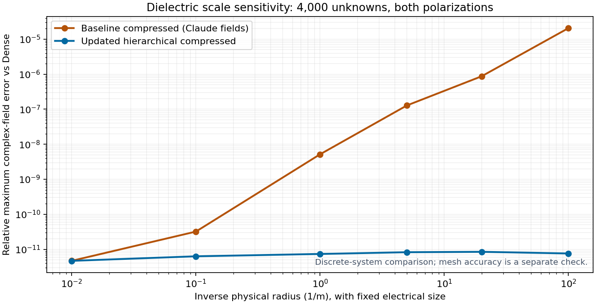

# Solver workflow improvements: implementation and Claude review handoff

Branch: `codex/solver-workflow-improvements-2026-11-12`.
Base: `b3c6b7c080849da0fdb0768e3d7ae74360018aa1` (production source `cfe005abb803b6218d5b97c16d7d5eb4c22a6883`).
Reviewed Claude report: `audits/claude-2026-11-12/solver-workflow-experiments-review/REVIEW_AND_RECOMMENDATIONS.md`, pinned at `3b5fa59ad7c04fbcc16c6a27aa0746d5334bc953`. All 22 report/evidence blobs were verified against that Git tree.

## Scope and decisions

This branch implements the supported numerical, planning and bounded overhead changes. It retains both Dense and compressed. Symmetry specialization remains excluded by the scope decision recorded in Claude's report. No GUI controls, native binary interfaces, dependencies, precision defaults or mesh-certification thresholds change.

| Recommendation | Implementation / disposition |
|---|---|
| Scale-aware compression | Dimensionless hierarchical compression **and refinement**, retaining physical coefficients and physical gates. Normalizing compression alone was insufficient. |
| Automatic lean Dense | Price disk residuals against the same 80% target used for selection; retain per-mesh plans, reprice cached forecasts, inherit plans through nested solves, recheck current RAM and scratch. |
| Assembly overhead | Fast validation for strictly sorted node-ID subsets; arbitrary ordering, duplicate checks, range checks and ownership remain supported. |
| Process scans | Throttle **diagnostic descendant enumeration** to 1 second. Parent RSS remains 50 ms. Live admission and owned-worker checks are unchanged. This is deliberately not a cache of available RAM. |
| Numeric BLAS caps | Hierarchical compressed factors use their small-product single-thread BLAS policy for numeric caps as well as `auto`; assembly/range workers still use their allocation. |
| Parallel inverse work | Coarse BLAS and sibling-solve experiments remain audit-only pending the measurements below. No new production inverse-construction concurrency. |
| Frequency reuse | Measure a three-frequency fixed-mesh sweep and independent Dense references. Do not introduce an unmeasured inverse/geometry cache. |

## Why the scale fix needs two changes

For Galerkin matrix coefficients, single-layer S, double-layer D/K and hypersingular W carry length powers two, one and zero. The unequal equation units make a single physical matrix norm a poor compression target. `compressed/scaling.py` supplies positive diagonal multipliers R and C; ACA/QR/SVD rank selection uses `R A C`, then the factors are unscaled before storage. The single-dielectric formulation uses `R=diag(k I,I)` and `C=diag(I,k I)`. Regional flux and trace rows use k and k² respectively, with conductor equation masks and sheet endpoint constraints respected.

The first prototype, compression normalization alone, reduced the worst dielectric field difference from 2.07e-5 to 1.02e-6. Physical-only refinement could still stop early. The final implementation also tests the dimensionless normwise backward error, using `y=C^-1 x` and `R b`; transpose/adjoint solves exchange R and C. GMRES receives a conservative physical stopping target that satisfies both criteria. Exact sample-row validation also checks both systems.

The existing physical gates remain: 1e-11 sampled operator error, refinement target 3e-15, 1e-12 physical solve and exact sample-row gates, and the existing condition limit. No global tolerance was loosened or uniformly tightened. Two additional real scaling vectors are charged to both retained storage and its forecast. Uniform scaling reuses existing norm sums; mixed-unit systems need an additional bounded norm pass.

### Scale measurements

| Radius (m) | Updated hierarchical vs same-scale Dense |
|---:|---:|
| 100 | 4.697e-12 |
| 10 | 6.332e-12 |
| 1 | 7.388e-12 |
| 0.2 | 8.279e-12 |
| 0.05 | 8.499e-12 |
| 0.01 | 7.633e-12 |



The final-source compression-only causal control reproduced **1.0165e-6**; the full fix produced **7.6327e-12** at radius 0.01. These are 4,000-unknown dielectric systems.

Errors here are `max(abs(test-reference))/max(abs(reference))` over complete complex fields for both polarizations and 19 angles. They are not relative errors at individual angular nulls. Materials and electrical size are fixed; physical radii span 100 to 0.01 metres. The corresponding frequencies intentionally span well beyond the user's ordinary band: this is a units/conditioning experiment, not a full-size desktop capacity claim.

### A Dense-reference limitation uncovered by the extended control

The smallest coated control initially appeared to be a remaining compressed error: its same-scale Dense comparison was 2.87e-8. Cross-scale comparison showed the opposite: Dense at radius 0.01 shifted by 2.90e-8 relative to the well-scaled Dense control at radius 100, while the new compressed results stayed around 8e-10 across the scales. The three-extra-correction Dense experiment below checks this independently. It is a research reference, not a new production Dense default.

Dense radius 0.01 with three extra physical correction steps agreed with Dense radius 100 to **1.221e-11**, versus **2.902e-8** before the extra steps. This supports improving Dense’s scale-aware stopping criterion; it does not justify imposing three unconditional steps on every solve.

The forced legacy-tile dielectric control differed from Dense by **1.533e-7** at radius 0.01, versus **3.115e-12** at radius 100. Three extra tile corrections improved the small-scale result only to **2.271e-8**, so refinement alone did not remove its operator-accuracy floor. The legacy path needs both compression and stopping-rule work before claiming the hierarchical fix applies to it.

The large-scale coated comparison is intrinsically less accurate than the dielectric comparison, around 8e-10. Do not extend the dielectric's approximately 1e-11 result to every formulation. The new scaling is for the hierarchical operator; excluded formulations and the legacy tile fallback retain their existing numerical policy. Forced tile and thin-layer controls are included below.

## Automatic must execute what it priced

Forecast records now include each backend's complete memory plan. Every refresh replaces these plans under the current allocation. Actual Dense execution carries a matching selected disk plan and its batch limit even if RAM later increases. Lost scratch space rejects that attempt rather than silently spending the planned saving; ordinary Automatic retry remains available. Different mesh sizes replan. Explicit memory storage remains explicit, and remote submission forecasts retain their conservative two-matrix assumption.

Two additional defects were addressed during validation: nested configured calls were replacing the outer forecast with `None`, and using only the original stable reservation could miss a lean plan after another process consumed RAM. Nested calls now inherit the request forecast, and the storage decision uses the live solve limit with its existing ownership credit and hard caps. Optional paired assembly cannot spend Automatic's selected headroom.

| Case | Executed backend / residual storage | Wall (s) | Peak process RSS (GiB) |
|---|---|---:|---:|
| Baseline, 0.85 GiB cap | Compressed | 31.24 | 0.391 |
| Updated, 0.85 GiB cap | Dense / disk | 17.87 | 0.345 |
| Updated, 1.0 GiB cap | Dense / memory | 18.62 | 0.579 |

At 0.85 GiB, the selected disk forecast was 708,669,440 bytes and execution reported `selected_plan_carried=True`; the original matrix was 256,000,000 bytes. At 1.0 GiB, the memory plan was 837,048,320 bytes. Complete fields agreed with the independent Dense control within 1.46e-11. A separate real cached-selection test repriced memory Dense at 4 GiB to disk Dense at 0.85 GiB, then to compressed after scratch became unavailable (`planner-refresh.json`).

Disk residual storage still means an in-RAM LU factor with streamed original-matrix residuals. This branch does not add disk LU. Disk use can reduce RAM while increasing I/O and time.

## Performance: measured tradeoffs

| Compressed workload | Before median [range], s | After median [range], s | Before / after peak RSS range, GiB |
|---|---:|---:|---|
| PEC, 8,000 unknowns, 181 angles, numeric 4 threads | 58.44 [52.71–64.17] | 46.38 [44.50–48.26] | 0.990–0.997 / 0.994–1.026 |
| Airfoil, 17,120 unknowns, 19 angles, auto threads | 109.58 [107.71–111.45] | 149.87 [124.53–155.73] | 1.266–1.280 / 1.255–1.301 |
| Dielectric, 8,000 unknowns, 181 angles, auto threads | 62.24 [59.01–65.47] | 66.70 [60.35–73.06] | 1.002–1.076 / 1.236–1.295 |

PEC improved about 21% by these medians. **Airfoil slowed about 37%, and dielectric about 7%; dielectric peak RSS also increased.** This is an accuracy-first change with targeted overhead reductions, not the projected universal 25% assembly speedup. There are two repeats per cell, except three updated airfoil runs; the excluded airfoil baseline was replaced. Host variability remains substantial. The 3 GHz airfoil independently agreed with Dense to 1.787e-10; PEC 8k comparisons use an independent Dense solve and agree within 3.23e-12. The 6 GHz airfoil comparison is against the old compressed implementation, not an independent Dense reference.

Fresh-process runs were sequential. Tables report medians and observed ranges, not confidence intervals. The first airfoil baseline spanned an environment reconnect and is excluded from timing comparisons; its raw result remains available. Other slow first runs remain included. Stage timers are inclusive and can overlap, so their sums are not independent wall-time budgets.

The accuracy fix can increase ranks and work. On the 17,120-unknown airfoil, one polarization's retained operator increased from 384,665,152 to 394,470,656 bytes; queried coefficients increased from 39,154,892 to 41,090,734. The measured mean interaction-list rank increased from 20.78 to 22.24. There is no claim that these changes make every compressed solve faster or smaller.

| Audit-only PEC 8k experiment | Wall times (s) | Field difference vs updated serial control |
|---|---|---:|
| Serial control | 56.15, 46.92 | 0.000e+00 |
| Coarse-block four-thread BLAS | 57.75, 62.57 | 5.005e-15 |
| Root-sibling parallel solve | 48.85, 48.28 | 0.000e+00 |

Coarse BLAS lost; root-sibling solve overlapped the serial range and showed no reliable general gain. Neither is promoted. Larger coefficient-query caps and a persistent scatter-map cache are also deferred: the measured airfoil averaged about 22,000 coefficients/query, far below the roughly 699,000-coefficient 16 MiB planning cap. Raising the cap alone is not demonstrated to remove that overhead. Strictly sorted IDs now avoid repeated uniqueness sorting without retaining an unbounded cache.

The sibling-solve prototype forks only the root's independent children, joins them even on failure, and leaves child recursion serial. Coarse BLAS widens only sampled inverse blocks with both dimensions at least 1,024. Both are isolated in `research_hooks.py`; neither changes the production solver. Parallel **construction** still needs shared-budget, cancellation and lifetime accounting before promotion, rather than simply submitting recursive builds to a pool.

### Sweep reuse and process scanning

The three-frequency coated sweep took 61.88 s in the pre-throttle profile and 54.35 s in the final profile. Diagnostic process-tree calls fell from **235 / 2.229 s** to **55 / 0.490 s**. These are single instrumented runs; do not attribute the entire wall-time change to the scan throttle. Final panel, mesh, cluster, partition and assembly-geometry timers totaled **0.498 s**, under 1% of wall time (inclusive counters, not an exact disjoint budget). Complete fields agreed with independent single-frequency Dense solves within **3.485e-10**.

The final airfoil profile still spent 2.683 s in 113 descendant samples and showed `unique` in approximately 5.1% of sampled stacks. That share is not a controlled same-host comparison with Claude’s earlier 11%. No scheduler allocation scan was called on this host, which had no SLURM allocation variables; the production change is diagnostic sampling only.

These counters cover panel/mesh construction, cluster preparation and `AssemblyGeometry` construction. They do not account for every frequency-independent geometric operation inside coefficient queries, nor prove that adjacent-frequency inverse reuse is unhelpful. Near-pair routing and a safely accounted neighbouring-frequency preconditioner remain separate research questions. No cross-frequency factor is retained by this branch.

## Validation and limitations

**85 recorded single-request attempts completed with no runtime errors and no production discrete-quality-gate failures**, including retained preliminary and research-hook runs. Two additional overlapping requests matched their serial reference bitwise and passed their gates. All **11 focused regression tests** passed; source compilation and whitespace checks passed. All complete-field comparisons were finite.

P2/P3 dielectric/coating comparisons ranged from approximately 1e-12 to 2.38e-10. Disabled-native assembly agreed with its Dense control to 1.06e-12. Exact-coefficient random RHS tests covered three RHS columns, both polarizations, and normal/transpose/adjoint inverses: worst dimensionless forward error 7.04e-12 and physical backward error 5.3e-17. IBC, sheet and thin-layer complete-field differences were 1.00e-13, 1.05e-13 and 1.32e-10 respectively. Thin-layer compressed took 86.27 s versus 6.42 s Dense; unsupported hierarchy cases still use legacy tiles, so there is no speed guarantee. See raw JSON for exact timings and per-channel backend selection.

The summary distinguishes backend agreement from old-versus-new result changes. It does not label the known Dense/tile limitations or differences against an inaccurate old compressed result as accuracy passes.

The suite includes complete fields, both polarizations, six dielectric scales, three coated scales, PEC scale controls, P2/P3 dielectric and coating controls, native and disabled-native paths, a certified solve, random exact-coefficient RHS checks for normal/transpose/adjoint inverses, constrained Automatic execution, overlapping requests, IBC/sheet/thin-layer controls and a fixed-mesh frequency sweep. Focused regressions cover changed capacity, carried batches, scratch failure, explicit storage, nested planning, optional partner admission, node-ID ordering/aliasing, and BLAS restoration after exceptions.

Analytical cylinder checks are separate from backend comparisons. The coarse P1 coated stress mesh has approximately 0.165 dB TE error against the cylinder series, in both Dense and compressed. Its discrete-system gates passing does **not** certify mesh accuracy. The raw study-only analytical failures are retained; they must not be summarized as production gate failures or hidden by changing the analytical threshold.

Of **148 per-case/frequency/polarization analytical checks**, **13 exceeded the study-only 0.05 dB threshold**, all coarse P1 coated TE controls. Raising the coated case to P2 at the same geometry/frequency reduced the error to **0.00962 dB TE / 0.00876 dB TM**, passing both checks. This is a mesh-order control, separate from the solver scaling repair. The analytic helpers are the repository’s cylinder-series implementations; they are independent of the Dense linear solve but not an external reference package.

Host: Linux, four-CPU cgroup allocation and 16 GiB cgroup RAM; NumPy 2.3.5 and SciPy 1.17.0. This is not a physical 32 GiB capacity run, a Windows validation, or a distribution certification. The native libraries were not changed. Process high-water RSS is measured; diagnostic descendant samples can miss brief child peaks, and process RSS does not charge all OS file cache.

## Reproduction and review requests

`SOURCE_IDENTITY.json` records every changed production blob and the aggregate backend source hash. `RUN_NOTES.json` identifies intermediate runs and the single timing exclusion. `SUMMARY.json`, `ANALYTIC_CHECKS.json` and the plot are directly readable. The hashed evidence archive includes all raw JSON, full complex `.npy` arrays, profiler output, generated boundary geometries, original Claude evidence and scripts. It contains numerical prototypes with known limitations as well as final runs.

From the repository root, with the usual runtime dependencies installed:

```bash
REPORT=audits/codex-2026-11-12/solver-workflow-improvements
python "$REPORT/unpack_evidence.py" /tmp/grim-workflow-evidence
GRIM_EVIDENCE_DIR=/tmp/grim-workflow-evidence python "$REPORT/analyze.py"
GRIM_EVIDENCE_DIR=/tmp/grim-workflow-evidence python "$REPORT/analytic_checks.py" "$PWD"
PYTHONPATH=tools/GHOST python "$REPORT/test_regressions.py"
python "$REPORT/test_planner_refresh.py" "$PWD" /tmp/planner-refresh.json
OPENBLAS_NUM_THREADS=1 OMP_NUM_THREADS=1 python "$REPORT/test_parallel_requests.py" "$PWD" /tmp/parallel-requests.json
```

To rerun solves, use a fresh output directory because the runners skip existing results. Create a separate checkout at base `b3c6b7c080849da0fdb0768e3d7ae74360018aa1` for baseline comparisons:

```bash
export GRIM_ROOT="$PWD"
export GRIM_BASELINE_ROOT=/absolute/path/to/base-checkout
export GRIM_EVIDENCE_DIR=/tmp/grim-workflow-new-results
python "$REPORT/run_scale.py"
python "$REPORT/run_followups.py"
python "$REPORT/run_final_controls.py"
python "$REPORT/run_epilogue.py"
python "$REPORT/analyze.py"
python "$REPORT/analytic_checks.py" "$PWD"
```

`sample_solve.py ROOT JSON_SPEC` also runs individual cases. All runner processes use one initial OpenBLAS/OMP thread and a four-CPU solver allocation; case options may then request `auto` or numeric four threads. The research controls are injected only by the audit harness. Timing reruns should be sequential on an otherwise idle machine. Preliminary files are retained evidence, not regenerated by the final-source runners.

Please review especially:

1. The dimensional powers and boundary-row masks in `compression_scales`, including regional flux/trace conventions, sheets and nonlocal thin-layer exclusions.
2. Both refinement criteria and the transpose/adjoint transformation; confirm that the conservative GMRES target and sampled gates retain their physical authority.
3. The selected-plan lifetime through nested solves, cached repricing, remeshing, scratch loss and a live limit below the original reservation. Confirm that explicit storage and remote planning remain conservative.
4. The performance tradeoffs and negative experiments. Check that telemetry throttling is never used as admission credit.
5. The Dense extreme-scale reference finding and the legacy tile controls: decide whether generic equilibrated Dense/tile refinement should be the next numerical change before further precision or rank reductions.

All original repository entries are preserved by building the publication tree on the complete remote base tree. Claude's report branch was used as review evidence, not as a replacement production snapshot.
