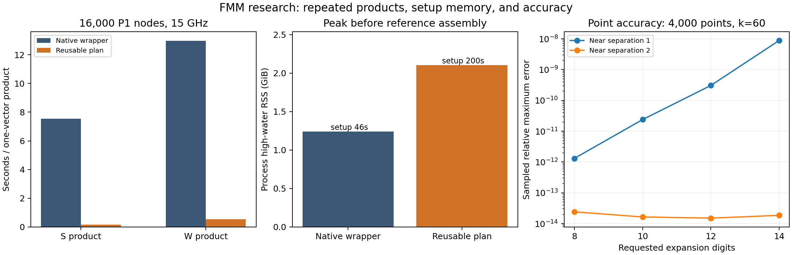

# FMM follow-up: review, measured improvements, and remaining limits

Research branch: `codex/fmm-followup-2026-11-13`, based on `8777e23eba7730dd94af05b706d08c4f27c9ef29`. Reviewed Claude's requested report first, pinned to `fe0a8eb785d6697b9b008e45798ab48eda311f43`.

## Decision

Continue investigating FMM, especially reusable wideband plans and preconditioning. Keep Dense and Compressed in production. The new reusable Galerkin prototype makes repeated products dramatically faster, but its current near-field setup is expensive, its memory can exceed the native FMM wrapper, and fine detail at fixed frequency exposes quadratic near-field growth. This is research evidence for a development direction, not a new production solver or a desktop capacity guarantee.

There are no user-facing option changes. All 526 non-audit files, including shipped DLL/.so files, match the parent branch. The new code lives under `audits/`; it is not imported by the application. The native comparison reuses the locally built FMM2D research library; no external native library is distributed.

Read [REVIEW_OF_CLAUDE.md](REVIEW_OF_CLAUDE.md) for the audit findings, [RESEARCH_DIRECTIONS.md](RESEARCH_DIRECTIONS.md) for the literature and architectural implications, and [REPRODUCTION.md](REPRODUCTION.md) for exact reruns. [QUESTIONS_FOR_CLAUDE.md](QUESTIONS_FOR_CLAUDE.md) is the second-audit checklist.

## What was implemented and tested

- A research derivative of Claude's reusable diagonal FMM with configurable near separation, passive complex wavenumbers, target gradients, tiled product scratch and streamed near-point construction.
- P1 Galerkin S, K, K' and W using that reusable plan. Entire panels share a leaf; near panel interactions are integrated with GHOST's routines, avoiding stored quadrature-point near matrices.
- A sparse near-block ILU candidate, compared with no preconditioner and the prior dense-extracted local-band ILU on complete PEC/TE/TM systems.
- Independent thread/process repetitions, full complex fields, all-angle fresh residuals, sampled direct residual checks, process-tree RSS/PSS measurements and unmonitored timing controls.
- Large real/lossy point holdouts, same-Galerkin-mesh native comparisons, tighter Nyström solves and geometry-only near-field growth counts.

The host has four CPU equivalents and 16 GiB, not the user's assumed 32 GiB desktop. Numerical kernels use one BLAS/OpenMP thread unless angle workers are specified. Resource sampling and host variation affect clocks. Heavy suites ran sequentially; lightweight auditing occurred while long jobs ran. Setup figures are single runs, and product figures average two applications unless stated otherwise.

## Reusable Galerkin: faster products, expensive setup

The large tests use the same 0.2-amplitude star, P1 mesh, eight quadrature points per panel, vector and sampled exact rows for both engines. Its circumscribing diameter is 20 feet. S is the single-layer operator and W is the hypersingular operator: these are component operations inside a solve, not complete large scattering solves. Native means the prior wrapper, which rebuilds FMM2D's internal state on each call. Reusable means the new cached diagonal plan with integrated near blocks. No claim is made against an optimized split/reusable FMM2D interface.

| Panels / frequency | Engine | Setup s | Mean S s | Mean W s | Peak before reference GiB | Worst sampled error |
|---|---|---:|---:|---:|---:|---:|
| 4,000 / 2 GHz | native | 7.22 | 1.6364 | 2.9028 | 0.334 | 8.93e-15 |
| 4,000 / 2 GHz | cached | 338.07 | 0.0412 | 0.1203 | 0.953 | 1.20e-14 |
| 16,000 / 15 GHz | native | 46.34 | 7.5478 | 12.9647 | 1.242 | 8.44e-14 |
| 16,000 / 15 GHz | cached | 199.89 | 0.1757 | 0.5402 | 2.103 | 1.02e-13 |

High-water RSS includes setup and products but is captured before direct-reference assembly. Retained counters exclude some Python/geometry overhead and are not used as peak-memory claims. All product arrays and the exact 16 sampled rows are archived. Random-vector sampled agreement is not an operator-norm guarantee.

At 4,000 panels, the measured product speedups are **39.7× S** and **24.1× W**. Recovering the extra setup needs approximately 207 S products, 119 W products, or 76 pairs of one S and one W application. These are arithmetic break-even estimates from measured products, not end-to-end angle crossover measurements.

At 16,000 panels, the measured product speedups are **43.0× S** and **24.0× W**. Recovering the extra setup needs approximately 21 S products, 12 W products, or 8 pairs of one S and one W application. These are arithmetic break-even estimates from measured products, not end-to-end angle crossover measurements.

The integrated near constructor is the next obvious implementation bottleneck. It builds coefficient arrays and converts them to sparse matrices; streaming directly into a shared sparse structure could reduce construction peaks. A fused formulation product could avoid separate S/K traversals. Neither improvement is included in the quoted clocks.

## Accuracy: higher order alone was the wrong knob

At 4,000 star points and k=60, two random complex charge/dipole columns and 32 independent exact target rows:

| Expansion digits | One-box near separation error | Two-box near separation error |
|---|---:|---:|
| 8 | 1.31e-12 | 2.42e-14 |
| 10 | 2.40e-11 | 1.65e-14 |
| 12 | 3.08e-10 | 1.51e-14 |
| 14 | 8.89e-09 | 1.86e-14 |

Widening the near stencil suppresses the measured diagonal-translation cancellation. It does not prove arbitrary accuracy on all geometries. Three-box separation added storage with no useful gain in this grid. Complex-k down translations and target factors must be computed explicitly: conjugating the up factors is only valid for real k. Gradients were checked independently against direct Hankel derivatives.

The grid above used the archived pre-streaming variant. The final constructor streams point-near CSR data, and the following holdouts use the final implementation:

| Holdout | Point error | Charge-gradient error | Setup s | Product s | Peak before reference GiB |
|---|---:|---:|---:|---:|---:|
| point-holdout-16k-loss | 1.26e-13 | 7.05e-15 | 6.93 | 0.1518 | 0.559 |
| point-holdout-16k | 7.09e-14 | 1.67e-14 | 7.03 | 0.1600 | 0.559 |
| point-holdout-64k | 2.33e-13 | 9.66e-14 | 30.97 | 0.8372 | 2.042 |
| point-holdout-stream | 1.64e-14 | 5.04e-15 | 3.54 | 0.0637 | 0.374 |

For the matched 4,000-point case with gradients enabled in both versions, streaming construction reduced process peak from 0.904 to 0.374 GiB (58.6% reduction). This is a construction-memory result, not a change to the mathematical operator.

The original complete-system tests exposed a failure at k=3: the forced two-level diagonal tree gave operator errors around 4e-9 to 1.2e-8 and failed the linear checks. The final prototype detects when this minimum-depth tree would have subwavelength leaves and evaluates its complete 4x4 near grid directly, subject to the allocation guards. Initial failures and the pre-fix source are preserved in `initial_low_frequency/`; the table below uses the reruns. This bounded direct fallback fixes these electrically small cases but is not a scalable low-frequency FMM. The k=0.5 control is also all-near. A stable adaptive wideband method remains necessary for general refinement.

## Complete discrete systems and preconditioning

These small tests retain the dense reference, exact scales and norms. They validate the implementation and convergence; their memory is not evidence of matrix-free capacity. Material is eps_r=3-0.08i; TE/TM use the production transmission formulation. Fields contain 180 observation angles and one or three incident angles, as recorded in JSON. The PEC equation is Dirichlet/TM combined field.

| Case | No-preconditioner iterations | Near-block ILU iterations | Near ILU solve s | Physical / scaled backward error | Complex field error | Near ILU checks |
|---|---|---|---:|---|---:|---|
| PEC N=64 k=3 circle | [13, 14, 15] | [1, 1, 1] | 0.004 | 1.37e-15 / 5.31e-16 | 3.21e-15 | pass |
| PEC N=128 k=3 circle | [12, 12, 12] | [2, 2, 2] | 0.009 | 1.17e-15 / 7.00e-16 | 5.12e-15 | pass |
| TE N=128 k=3 circle | [28, 28, 28] | [7, 7, 7] | 0.097 | 2.96e-15 / 1.65e-15 | 2.18e-14 | pass |
| TE N=128 k=12 star | [185, 223, 225] | [13, 13, 13] | 0.354 | 3.13e-15 / 3.08e-14 | 4.19e-13 | pass |
| TE N=512 k=40 star | [480] (failed) | [152] | 27.080 | 4.19e-16 / 1.42e-14 | 1.26e-13 | pass |
| TM N=128 k=3 circle | [27, 27, 27] | [7, 7, 7] | 0.101 | 1.25e-15 / 4.47e-16 | 4.27e-15 | pass |
| TM N=128 k=12 star | [133, 140, 140] | [15, 15, 16] | 0.394 | 9.85e-15 / 3.84e-14 | 5.46e-13 | pass |
| TM N=512 k=40 star | [480] (failed) | [148] | 19.571 | 1.25e-15 / 2.93e-14 | 2.01e-13 | pass |

The 512-panel star is the decisive convergence example: no preconditioner and local-band ILU both exhausted 480 iterations in both polarizations, while near-block ILU converged in 152 (TE) and 148 (TM), with about 8 MiB of factors instead of about 1 MiB for local-band ILU. Failure cases remain in the table/raw results.

The physical checks are less accurate than those same-mesh comparisons: PEC circle complex backscatter error fell from 0.4905% at 64 panels to 0.1226% at 128 panels; the 128-panel dielectric circle RCS errors were 0.5658% TE and 0.2094% TM. These are discretization effects, not evidence of a failed discrete linear solve.

Near-block ILU coefficients are constructed from the FMM's near operators, but scaling still comes from the dense validation matrix. On small/low-frequency examples the near matrix can include a large fraction of the full operator, so tiny iteration counts do not establish large-scale performance. The raw results also retain the old local-band ILU and all nonconvergence results. Production certification additionally requires condition-estimator design, mesh checks, and missing geometry/material holdouts.

## Tight Nyström and physical phase checks

This controls the difference between iterative tolerance, exact-operator residual and physical discretization error.

| Case / engine | Exact relative residual | Normwise backward error | Complex field vs dense | Complex circle vs analytic |
|---|---:|---:|---:|---:|
| circle ppw=20 / claude | 1.83e-11 | 1.37e-11 | 4.77e-11 | 7.53e-05 |
| circle ppw=20 / cached | 2.62e-13 | 1.15e-13 | 5.34e-13 | 7.53e-05 |
| circle ppw=40 / claude | 1.80e-11 | 1.29e-11 | 4.56e-11 | 9.47e-06 |
| circle ppw=40 / cached | 2.63e-13 | 1.15e-13 | 5.34e-13 | 9.47e-06 |
| circle ppw=80 / claude | 1.80e-11 | 1.39e-11 | 4.60e-11 | 1.19e-06 |
| circle ppw=80 / cached | 2.63e-13 | 1.14e-13 | 5.34e-13 | 1.19e-06 |
| star ppw=12 / claude | 1.77e-10 | 1.34e-10 | 2.06e-10 | — |
| star ppw=12 / cached | 9.40e-13 | 9.03e-14 | 5.61e-13 | — |

The complex circle error falls by approximately 8× each time points per wavelength double (20 → 40 → 80), confirming third-order convergence in this control. The analytical comparison includes phase; RCS agreement alone could hide sign/phase errors. Physical mesh/quadrature error is expected to be much larger than the discrete linear residual. Neither a low backward error nor a same-mesh dense comparison certifies the mesh.

## Angle concurrency and corrected memory accounting

Batch size is eight. The first rows include the memory observer; the controls below omit it.

| Case | Strategy | Solve s | Parent peak GiB | Process-tree sampled peak PSS GiB |
|---|---|---:|---:|---:|
| k=1150, 181 angles | threads | 738.71 | 2.594 | 2.424 |
| k=640, 61 angles | batch | 220.51 | 0.464 | 0.460 |
| k=640, 61 angles | processes | 218.55 | 0.450 | 1.223 |
| k=640, 61 angles | threads | 86.70 | 1.281 | 1.263 |
| k=320, 32 angles | batch | 44.26 | 0.253 | 0.250 |
| k=320, 32 angles | batch | 43.98 | 0.254 | 0.250 |
| k=320, 32 angles | threads | 16.32 | 0.643 | 0.526 |
| k=320, 32 angles | threads | 15.24 | 0.616 | 0.512 |

Unmonitored controls, k=320 / 32 angles:

- Repeat 1: serial 45.03 s, four threads 16.07 s (2.80×), four fork processes 16.32 s (2.76×).
- Repeat 2: serial 42.91 s, four threads 16.39 s (2.62×), four fork processes 23.97 s (1.79×).

An additional unmonitored k=640 / 61-angle four-process control took 93.37 s. Compare this separately with the monitored process row; do not attribute the entire observed timing difference to one cause without controlled repetitions.

Across matched strategies, complex amplitudes were bitwise equal in all 9 archived comparisons. The full k=1150 / 181-angle RCS relative difference from Claude's archive was 0.0. Fresh FMM L2 residuals were checked for every angle; independent direct checks covered 32 rows for every angle. The sampled maximum-entry residual and the all-angle L2 residual are different norms and must not be compared as if they were the same acceptance gate.

The full threaded run uses eight columns per worker; Claude's 16-angle memory run used four. Its 387-second 181-angle run used processes and reported only parent memory. Do not mix these into one time/RAM result. Summed RSS over fork processes double-counts shared pages, while sampled PSS may miss transient peaks. No Windows result is claimed.

## What this means for a 32 GiB desktop

There is substantial headroom to investigate, but no demonstrated catch-all replacement. FMM avoids a full dense matrix and reusable plans can make its repeated work much cheaper. A dense complex128 matrix of dimension 19,806 alone takes about 5.85 GiB, before factors/workspace; the successful Nyström run is a useful capacity demonstration with its narrower accuracy/formulation contract.

Detailed meshes and thin layers remain a concern. At fixed 2 GHz, the star near-pair count grows from 1.80 million at 4,000 panels to 7.21 million at 8,000 and 28.82 million at 16,000. Two close interfaces with 16,000 panels each imply 27.59 GiB in the current constructor's coefficient-buffer formula alone. This geometry-only calculation is not a completed solve; it shows why the fixed wavelength-sized near field cannot be the final design. The prototype's 2/3 GiB allocation guards are research safeguards, not production RAM settings.

Priorities:

1. **Adaptive wideband reusable plans**, to retain fast high-frequency products while subdividing crowded low-frequency leaves safely. The 2010 complex-Helmholtz wideband work and the recent stable matrix-form FMM paper are relevant algorithmic references, not GHOST benchmarks.
2. **Cheaper near construction and bounded sparse preconditioning**, with scalable scaling and complete TE/TM/coated/corner tests. Check total setup + iteration cost, not just iteration count.
3. **Matrix-free certification and a shared-plan angle scheduler**, with explicit adjoints, inverse actions, numerical-failure handling, cancellation and memory admission. Preserve the current accuracy contract until evidence supports a deliberate alternative.
4. **Matched end-to-end comparisons** against Dense/Compressed for 1, 16 and 181 angles. The earlier 80–90-angle crossover is not a valid routing threshold.

One Automatic user workflow can eventually choose among several internal engines. Dense remains attractive when it fits and many right-hand sides reuse its factors; Compressed retains the direct multi-angle advantage; FMM is most interesting when storage or factorization is the binding constraint. Current evidence does not justify deleting either backend.

## Evidence and limitations

The evidence archive and `SUMMARY.json` retain successful and failed outcomes. The analysis script recomputes errors from the archived complex arrays. Source identities, environment, all-angle resource traces and the original unchanged Claude validation rerun are included. No large layered/coated full solve, large Galerkin iteration sweep, Windows build, polynomial order beyond P1, open boundary, or production certification is claimed. External FMM2D licensing remains unresolved for distribution; no upstream binary is bundled.

