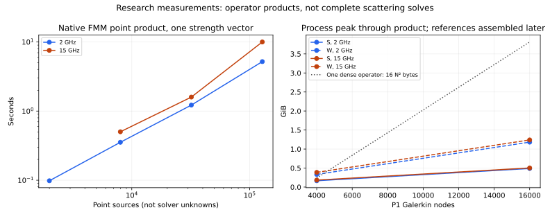

# Handoff: numerical follow-ups, selective precision and FMM research

## Decision

There are still substantial avenues for reducing RAM. FMM is the strongest architectural candidate investigated here, but the evidence supports developing a matrix-free operator plus a qualified preconditioner, not replacing the released solver today. Selective inverse precision is a nearer-term candidate. Scaling the inverse alone did not produce a convincing general memory win.

This branch contains **research only**: audit scripts, experimental adapters, reports and evidence. All 526 non-audit files match production base `09fec5b2663649e859f292211c9d490e6b9f615b`, including the shipped DLL/.so files. A separate native FMM2D `.so` was compiled and exercised locally. It is not installed into the application or included in the distribution. No user options, numerical defaults, quality gates or baselines were changed.

Read [METHODS_AND_IMPLICATIONS.md](METHODS_AND_IMPLICATIONS.md) for the primary-source research and architectural implications, and [REPRODUCTION.md](REPRODUCTION.md) for commands, source pins, dependencies and evidence interpretation.

## Claude review disposition

Reviewed report: `audits/claude-2026-11-13/solver-numerical-followups-review/REVIEW_OF_SOLVER_NUMERICAL_FOLLOWUPS.md`, Claude commit `c4204e7410af8f204f9b6ee56467feaa95868825`, report blob `270f1778e64b323f33ab598a793de987ee08cbeb`.

I verified 80 source/evidence blobs from that commit and independently recomputed 36 comparisons from Claude's 72 full field arrays. No failed solves appeared in that evidence and the relevant numerical comparisons support the review. That is an evidence recomputation; the new solves below are separate experiments, not a claim to have rerun all 72 original cases.

| Finding | Disposition |
|---|---|
| F1: Dense refinement adds cost | Confirmed mechanism; directly tested 1e-13 intermediate target against current 3e-15. Benefit depends on case and host. |
| F2: Dense reference answers changed | Correct. Preserve historical arrays and label new baselines with commit, policy and geometry; do not silently overwrite old evidence. |
| F3: 20-foot thin-coated star refused by condition gate | Still open. Neither FMM nor cheaper inverse storage makes an ill-conditioned formulation accurate. Existing 2.5e6 refusal remains; no new full-scale coating solve or gate change here. |
| F4: archive unpublished | Outdated: evidence was published at `09fec5b`, after Claude reviewed `ee66611`. That archive is retained in this branch's ancestry. |
| F5: initial inverse tolerance heuristic can cost storage | Valid. Tested coarse, scaled and reduced-precision inverse policies and a lossless-star holdout. No unconditional replacement rule established. |

Claude's accepted source transformations remain unchanged. The existing 207-test result is Claude's result; this report does not relabel it as a new run. The independent work here consists of new complete solver experiments, native/operator tests, analytic checks and source identity verification.

## Measurement boundaries

Host: Linux, Python 3.12.14, NumPy 2.3.5, SciPy 1.17.0, four-CPU quota and 16 GiB cgroup memory limit. Existing complete solver experiments use automatic backend CPU allocation; FMM experiments use one thread. Absolute timings therefore must not be read as a same-thread backend race or a forecast for the user's 32 GiB desktop.

Verification summary: 42 complete production-policy solves, 35 field comparisons, 18 random-RHS inverse-mode checks, 12 small Galerkin operator checks, nine point-kernel cases, nine physical system configurations with two preconditioners (46 RHS solutions), six analytic mesh-refinement comparisons, and eight large Galerkin products. `VERIFICATION.json` records the checked counts.

Every reported field difference is a global maximum complex difference divided by the maximum reference amplitude, not a pointwise relative error at a scattering null. Full arrays are retained. Complete solver hooks keep the existing physical/scaled residual and condition gates, but run one-shot mode without mesh certification. FMM research uses explicit algebraic comparisons and analytic circles; it has no production certificate or admission integration.

## Dense intermediate refinement target

The audit hook changes only the internal scaled refinement target. The final physical and scaled 1e-12 release limits, equilibration and bounded correction loop remain intact.

| Model | Current 3e-15 wall seconds, two runs | Experimental 1e-13 wall seconds, two runs | Mean change | Maximum field change |
| Dielectric, 8,000 unknowns | 47.55, 40.52 | 41.87, 37.37 | -10.0% | 8.88e-12 |
| Coated PEC, 6,480 unknowns | 31.83, 27.54 | 29.66, 28.96 | -1.3% | 2.89e-11 |

Both polarizations avoided one correction on these models. The dielectric result is consistent across the two pairs; the coated result is inconclusive as a speed claim because one experimental run was slower than its control. Two pairs are not a stable cross-machine performance estimate.

On disk-backed dielectric residuals, one pair fell from 46.08 to 39.30 s (14.7%). The 1e-13 disk and memory fields were bitwise equal; the strict pair differed by 5.0e-15. Peak process memory was about 1.19–1.24 GiB on disk versus 2.16–2.22 GiB in memory for these runs.

At fixed electrical size and radii 0.01 m and 100 m, the dielectric cross-scale drift increased from 1.08e-13 to 1.64e-12 with the looser target. The coated case was unchanged between targets and had 2.63e-11 cross-scale drift. The 1e-12 target gave no further benefit over 1e-13 in those scale cases. These scans deliberately rescale frequency inversely with geometry; they are numerical invariance tests, not a proposed operating frequency range.

**Recommendation:** 1e-13 is a reasonable candidate for a separately qualified performance policy. Its last-digit tradeoff is measured, but a universal speedup is not established. Keep the current strict default in this research branch; run hard geometry/scale and release-reference holdouts before promoting a change. Do not add another GUI option just for this experiment.

## Compressed inverse experiments

Policies: `control` is the current backend; `scaled` factors RAC and transforms solves back; `coarse` starts at 1e-8; `scaled-coarse` combines them; `float32` stores only selected low-rank inverse factors as complex64 while preserving complex128 leaf/Woodbury LU and the accurate operator. All policies retain final accuracy gates.

| Case/policy | Wall s | Peak process GiB | Final inverse MiB, TE / TM | Factorizations, TE / TM | Total refinement steps, TE / TM |
|---|---:|---:|---|---|---|
| coated-coarse | 14.55 | 0.489 | 57.1 / 55.7 | 1 / 1 | 10 / 10 |
| coated-control | 15.05 | 0.482 | 57.1 / 55.7 | 1 / 1 | 10 / 10 |
| coated-float32 | 15.48 | 0.467 | 36.5 / 35.6 | 1 / 1 | 10 / 10 |
| coated-scaled-coarse | 14.67 | 0.485 | 58.1 / 58.0 | 1 / 1 | 5 / 5 |
| coated-scaled | 15.58 | 0.456 | 58.1 / 58.0 | 1 / 1 | 5 / 5 |
| diel-coarse | 27.45 | 0.732 | 96.8 / 98.5 | 2 / 1 | 16 / 13 |
| diel-control | 26.40 | 0.692 | 96.8 / 98.5 | 1 / 1 | 13 / 13 |
| diel-float32 | 24.73 | 0.733 | 59.7 / 60.7 | 1 / 1 | 14 / 14 |
| diel-scaled-coarse | 26.22 | 0.693 | 106.6 / 122.2 | 1 / 1 | 7 / 7 |
| diel-scaled | 27.10 | 0.767 | 130.8 / 131.3 | 1 / 1 | 7 / 7 |

The dielectric case has 6,000 unknowns and the coated case 3,175. Each row is one run, so small timing changes are exploratory.

- Scaling cuts refinement work but increases dielectric final inverse storage by about 33–35% at the current initial tolerance. The scaled/coarse version avoids a rebuild yet still uses more inverse storage than control. This is not a general RAM improvement.
- Reduced precision cuts retained inverse storage about 38% for dielectric and 36% for coated. Including the unchanged operator, the reduction is only about 13% and 11%, before other allocations. Field differences from control are 1.32e-14 and 2.67e-13 respectively.
- The float32 dielectric process peak rises from 0.692 to 0.733 GiB even though its retained inverse is smaller. Construction still occurs in complex128 and conversion has temporaries. The coated peak falls modestly. Do not advertise the inverse-payload reduction as a total-RAM or admission-capacity win.
- The accurate operator is unchanged. This is not blanket float32 storage of a 1e-12-qualified matrix. Failure/rebuild behavior and transient upcasts remain important production work.

### Holdouts

- `holdout-adjoint-control`: wall 9.91 s; peak 0.20256423950195312 GiB; quality gate True; error `None`; inverse bytes [9804328, 9892080].
- `holdout-adjoint-float32`: wall 9.45 s; peak 0.20218658447265625 GiB; quality gate True; error `None`; inverse bytes [6804328, 6858480].
- `holdout-adjoint-scaled`: wall 11.42 s; peak 0.203826904296875 GiB; quality gate True; error `None`; inverse bytes [10549648, 10675992].
- `holdout-lossless-star-coarse`: wall 18.81 s; peak 0.3927116394042969 GiB; quality gate True; error `None`; inverse bytes [48574728, 48603424].
- `holdout-lossless-star-control`: wall 15.91 s; peak 0.4065971374511719 GiB; quality gate True; error `None`; inverse bytes [57127912, 56821824].
- `holdout-lossless-star-float32`: wall 16.73 s; peak 0.40308380126953125 GiB; quality gate True; error `None`; inverse bytes [35523912, 35347624].
- `holdout-lossless-star-scaled-coarse`: wall 14.92 s; peak 0.39940643310546875 GiB; quality gate True; error `None`; inverse bytes [53595104, 53260888].
- `holdout-thin-coating-control`: wall 6.3 s; peak 0.20587158203125 GiB; quality gate True; error `None`; inverse bytes [12676472, 12283592].
- `holdout-thin-coating-float32`: wall 6.2 s; peak 0.18881607055664062 GiB; quality gate True; error `None`; inverse bytes [9034648, 8800248].
- `holdout-thin-coating-scaled-coarse`: wall 6.23 s; peak 0.20883941650390625 GiB; quality gate True; error `None`; inverse bytes [12819128, 12647160].

All 42 complete solver experiments passed the existing quality gates. The lossless-star coarse inverse used about 15% less inverse storage but took 18.81 s versus 15.91 s; selective precision reduced its inverse storage about 38% yet took 16.73 s. Scaling plus a coarse start used about 6% less inverse storage on that holdout, but the benefit did not generalize to the main dielectric case. The largest holdout field change across these policies was 1.11e-14. These remain single-run timing observations.

The random-RHS holdout explicitly exercises normal, transpose and conjugate-transpose inverse actions against independently queried dense coefficients. Lossless-star and thin-coating holdouts check whether the same-mesh fields and existing gates survive the experimental policies. Full differences and all probe records are in `METHODS_ANALYSIS.json` and individual JSONs. These holdouts do not certify mesh convergence or resolve the full-scale coating refusal.

## Native FMM and Galerkin evidence

Built FMM2D commit `7e7509ecd6ebe31b9292cb00825410b478f44808` with GNU Fortran 14.2 and OpenMP, then called its 32-bit-integer Fortran ABI through ctypes. Charges, gradients and dipoles matched direct SciPy Hankel evaluations at real and lossy wavenumbers to approximately 2e-15–4e-15. Twelve P1 operator checks covered S, K, K' and W on circles/star, including a complex wavenumber: maximum relative product difference 4.80e-14.

### Point-kernel scaling: 20-foot envelope

These tests are **not Galerkin solves**. Each result checks 32 independently evaluated target rows and retains the complete output. The dense equivalent is a hypothetical matrix between the quadrature points, not the application's DOF matrix.

| Sources | GHz | Strength vectors | FMM seconds | Peak process GiB before validation | Sampled relative error |
|---:|---:|---:|---:|---:|---:|
| 2,000 | 2 | 1 | 0.098 | 0.052 | 1.26e-14 |
| 8,000 | 2 | 1 | 0.354 | 0.066 | 9.85e-15 |
| 32,000 | 2 | 1 | 1.221 | 0.136 | 1.62e-14 |
| 128,000 | 2 | 1 | 5.198 | 0.429 | 7.67e-15 |
| 8,000 | 15 | 1 | 0.502 | 0.082 | 1.04e-13 |
| 32,000 | 15 | 1 | 1.595 | 0.155 | 1.32e-13 |
| 128,000 | 15 | 1 | 10.006 | 0.450 | 9.15e-14 |
| 8,000 | 2 | 8 | 1.620 | 0.213 | 9.48e-15 |
| 8,000 | 2 | 32 | 6.865 | 0.706 | 1.22e-14 |

At 128,000 points a point-to-point complex128 matrix would occupy about 244 GiB. At eight quadrature points per panel, however, those points correspond to 16,000 P1 panels. A single 16,000-DOF Galerkin operator is about 3.81 GiB; a two-density 32,000-DOF system is about 15.26 GiB before its factor, work buffers and other allocations. These arithmetic comparisons illustrate potential, not a demonstrated 32 GiB full-model solve.

Batching 8 or 32 strength vectors improves time per vector but increases peak memory considerably. A bounded batch policy and reusable native plans are essential.

### Larger P1 Galerkin products

The following include quadrature maps and exact near/self corrections, with independently assembled samples of 16 complete Galerkin rows. They still exclude preconditioners, condition certification, Krylov iterations and far-field solves. Retained bytes count selected arrays only; process peak captures more of the implementation.

| P1 nodes | GHz | Setup s | Partial retained MiB | Operator | Product s | Peak through product GiB | Sampled row error |
|---:|---:|---:|---:|---|---:|---:|---:|
| 4,000 | 2 | 6.52 | 6.71 | S | 1.459 | 0.166 | 4.81e-15 |
| 4,000 | 2 | 6.52 | 6.71 | W | 3.132 | 0.333 | 8.93e-15 |
| 16,000 | 2 | 34.11 | 26.85 | S | 6.844 | 0.489 | 6.25e-15 |
| 16,000 | 2 | 34.11 | 26.85 | W | 15.862 | 1.182 | 2.63e-14 |
| 4,000 | 15 | 9.44 | 6.71 | S | 1.832 | 0.185 | 6.13e-14 |
| 4,000 | 15 | 9.44 | 6.71 | W | 3.884 | 0.387 | 8.6e-14 |
| 16,000 | 15 | 38.81 | 26.85 | S | 6.555 | 0.503 | 6.07e-14 |
| 16,000 | 15 | 38.81 | 26.85 | W | 14.501 | 1.240 | 8.44e-14 |

### Complete small systems and analytic checks

Complete discrete PEC Dirichlet and TE/TM transmission systems use the same integrated operators and retain a dense reference. The PEC research system uses a combined D+i*k*S representation; it is not a claim of complete coverage of the production regional formulations. Near ILU is extracted from a band of the dense reference in this study, so its construction is not yet matrix-free.

| System | Preconditioner | Iterations per incident angle | Solve s | Exact physical/scaled backward-error checks | Field difference from Dense |
|---|---|---|---:|---|---:|
| PEC, n=128, k=3.0, circle | none | [12, 12, 13] | 2.61 | pass | 7.2e-13 |
| PEC, n=128, k=3.0, circle | near_ilu | [18, 20, 19] | 4.07 | pass | 1.66e-14 |
| PEC, n=256, k=20.0, star | none | [71] | 12.78 | pass | 1.81e-13 |
| PEC, n=256, k=20.0, star | near_ilu | [87] | 15.97 | pass | 2e-13 |
| PEC, n=64, k=3.0, circle | none | [15, 14, 14] | 2.08 | pass | 7.03e-13 |
| PEC, n=64, k=3.0, circle | near_ilu | [15, 15, 15] | 2.15 | pass | 4.57e-15 |
| TE, n=128, k=12.0, star | none | [182, 223, 225] | 200.05 | pass | 1.27e-12 |
| TE, n=128, k=12.0, star | near_ilu | [76, 57, 57] | 59.57 | pass | 3.06e-13 |
| TE, n=128, k=3.0, circle | none | [28, 28, 28] | 19.64 | pass | 6.07e-15 |
| TE, n=128, k=3.0, circle | near_ilu | [31, 31, 31] | 21.14 | pass | 7.76e-15 |
| TE, n=64, k=3.0, circle | none | [30, 30, 30] | 15.68 | pass | 3.87e-15 |
| TE, n=64, k=3.0, circle | near_ilu | [19, 19, 19] | 8.89 | pass | 3.19e-14 |
| TM, n=128, k=12.0, star | none | [133] | 41.93 | pass | 4.62e-13 |
| TM, n=128, k=12.0, star | near_ilu | [65] | 20.90 | pass | 3.37e-13 |
| TM, n=128, k=3.0, circle | none | [27, 27, 27] | 21.53 | pass | 1.39e-14 |
| TM, n=128, k=3.0, circle | near_ilu | [28, 28, 28] | 20.84 | pass | 4.99e-15 |
| TM, n=64, k=3.0, circle | none | [29, 29, 29] | 13.56 | pass | 3.66e-15 |
| TM, n=64, k=3.0, circle | near_ilu | [21, 21, 21] | 10.10 | pass | 3.61e-15 |

Circle mesh doubling from 64 to 128 panels reduces PEC complex backscatter error from 0.4905% to 0.1226%, TE RCS error from 2.264% to 0.5658%, and TM RCS error from 0.8423% to 0.2094%. Thus tiny algebraic residuals are not equivalent to a tiny physical discretization error. The analytic checks test conventions independently of the assembled matrix; star cases have same-mesh discrete validation only.

Initial physical-system prototypes failed these independent checks because their manually constructed normal orientation and TE material-side mapping were wrong. Corrected and repeated results are the ones tabulated above; rejected evidence is retained under `preliminary-outward-system` and `preliminary-material-side`. No production source was affected. These failures show why matrix-to-matrix agreement alone is an inadequate acceptance criterion.

The small-system FMM prototype is far slower than dense LU after assembly. Its high-level calls rebuild native trees, it does not fuse all operator components, and iterative convergence can dominate. It demonstrates numerical feasibility and identifies the next engineering work; it does not demonstrate a faster replacement backend.

## Recommendations and acceptance criteria

1. **Keep both existing engines and one Automatic workflow.** There is no evidence that Dense, compressed or FMM dominates every size, frequency, material and angle count.
2. **Prioritize a production-shaped selective inverse-precision experiment.** Allocate lower-precision factors during construction; measure peak RAM, casts, retries and fallback. Require normal/transpose/adjoint checks, all existing numerical gates, complex fields, and lossless/coating holdouts. Do not weaken the accurately stored operator.
3. **Develop FMM behind an operator interface.** Reuse geometry/translation plans, fuse operator applications, bound RHS batches and near-field construction. Compare FMM plus the current hierarchical inverse against sparse/local and eventually operator preconditioners.
4. **Make full-solve high-frequency validation the next decision gate.** Required: 20-foot physical contours at 2/15 GHz (18 GHz holdout), mesh-refined PEC/dielectric/coatings, near gaps and corners, condition estimation including adjoint inverse actions, all-row physical/scaled residual verification, timeouts/cancellation, truthful memory admission and Windows packaging. Point products cannot satisfy this gate.
5. **Study formulation-specific conditioning separately.** OSRC/Calderón and directional nested formats are worthwhile research, with derivations and limitations explained in the companion paper survey. No measured GHOST speedup is claimed for unimplemented methods. Keep the 20-foot thin-coating refusal until a validated formulation resolves it.

The pinned FMM2D dependency has conflicting license notices: Apache-2.0 at the root and GPL-2.0-or-later in included Helmholtz source. This needs clarification before distribution integration. The experiment does not redistribute the external native library or claim Windows readiness.

## Questions for Claude's second audit

1. Does recomputing the archived full-field arrays reproduce every table, including the Dense scale drift and disk comparison? Is 1e-13 a worthwhile internal performance target, or should strict 3e-15 remain universal?
2. Verify `A^-1 = C (RAC)^-1 R` in the scaled inverse hook, permutation handling and normal/transpose/adjoint tests. Are there additional memory allocations missing from the prototype's resource model?
3. Audit the complex64 inverse-factor conversion, unchanged accurate residual operator, and all fallback paths. Which factor families could be created directly in lower precision without compromising refinement?
4. Independently derive the FMM H1-to-H2 normalization, dipole/gradient signs, P1 scatter/gather weights, near-subtraction correction and Maue W identity. Check the corrected inward-normal/material-side convention against analytic fields.
5. Identify coverage needed before an FMM operator can enter the production condition estimator and resource admission. In particular, how should all-row residual verification and operator norms remain bounded without rebuilding an N-by-N matrix?
6. Which preconditioner is the best first practical target for high-frequency TE/TM and thin coatings: existing hierarchical inverse, near-field ILU, Calderón or a derived 2-D OSRC? Please distinguish evidence from expected benefits.
7. Verify the external dependency provenance and propose a Windows build/ABI route. No production adoption should depend on this Linux prototype alone.

All unresolved scope is explicit: no complete large FMM scattering solve, no FMM mesh certification, no production FMM admission/condition path, no P2/P3/open-junction/thin-sheet FMM coverage, no Windows build, no GPU or out-of-core LU benchmark, and no measured OSRC/directional-H² implementation. These are follow-up requirements, not silent assumptions of equivalence.

## Published evidence

The verified archive contains 389 files, including 243 NumPy arrays (current experiments, Claude's pinned evidence and explicitly labeled preliminary experiments). It is 13,881,240 compressed bytes, split into 14 parts for transport. Combined SHA-256: `97538c56dece7b264612adf6bf371364937472f518f31a43dcc283cb226752b3`. `unpack_evidence.py` checks every part and every extracted file. Extraction into a new directory and the numerical verification script both passed before publication. Selected analyses and all experiment scripts are also directly readable in this audit directory.
