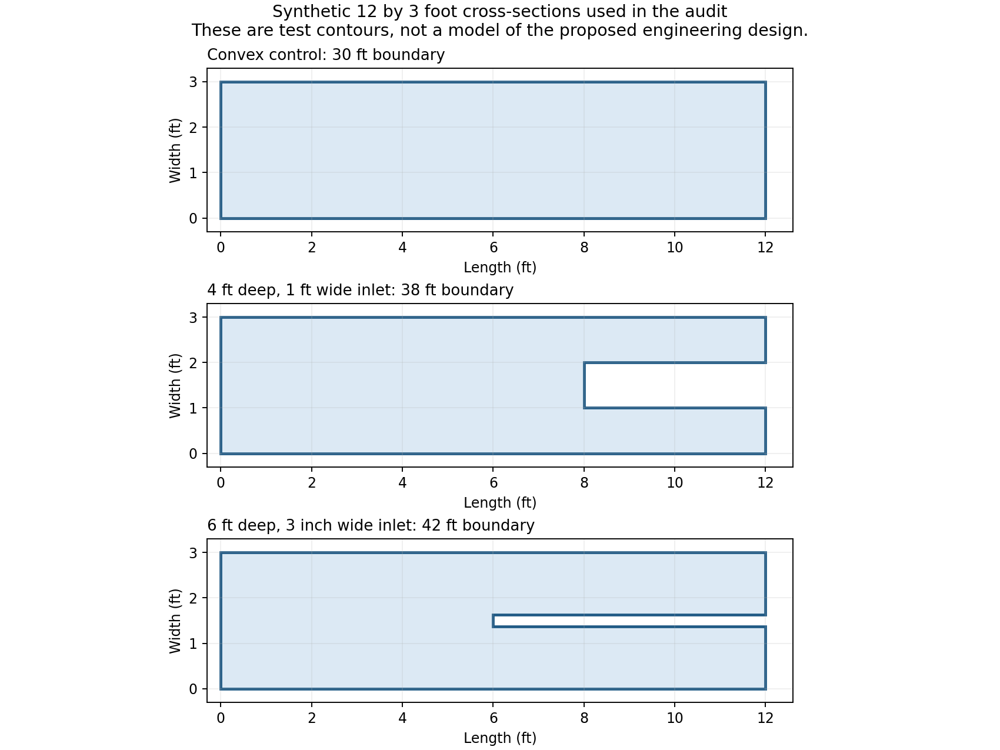

# Large geometry RAM and speed audit

Date: October 29, 2026. Scope: the current GHOST 2D backend, ten new isolated certified solves, twenty-five initial resource forecasts, the earlier scaled-airfoil results, and Claude's large-geometry audit.

**A 12-foot-long, 3-foot-wide cross-section with an inlet is within the demonstrated capability of this solver for some useful cases. Size and concavity alone do not make it infeasible.** New metal-inlet tests passed at 10 GHz using 1.31 to 1.73 GiB of sampled process-tree resident memory. A material-filled inlet using the first airfoil material passed at 1 GHz using about 1.49 GiB. These are specified synthetic contours, not a certification of an unspecified engineering design.

The most promising measured speed improvement was a stronger compressed preconditioner: **57.60 to 37.19 seconds at the median, a 35.4% reduction**, with only about 16.5 MiB difference between the maximum sampled RSS of the two configurations. Smaller angle batches reduced the scaled airfoil's sampled RSS by **250 MiB, or 18.7%**, for about **1.46 seconds, or 2.5%, more solve time** in a one-run comparison. Neither experiment changed production source or weakened accuracy gates.

For cases that truly exceed RAM, the current solver cannot stream its entire active factorization through disk. It needs a new capacity path: first consider a bounded iterative solve using the existing hierarchical operator and a smaller preconditioner; then add disk-backed active blocks or a fast-multipole operator as the limiting allocation requires. A generic out-of-core dense LU is possible but is a substantial implementation and can be very slow.

## Scope and reproducibility

The assessment assumes a **2D cross-section**. It does not establish the feasibility or scattering accuracy of an arbitrary finite 3D inlet, wing, or vehicle. A 2D section omits finite-span and end effects. The user's actual boundary, materials, frequency band and intended RAM reservation are still needed for a design-specific answer.

New solves used Windows, Python 3.11, four assembly/BLAS threads, double precision, 361 incident angles from 0 through 360 degrees, both polarizations, an 8 GiB admission budget, adaptive meshing and all existing quality/convergence gates. The host has about 31.1 GiB installed RAM. Each solve ran in a fresh subprocess. An external monitor sampled parent plus descendants every 100 ms and would stop a case after ten minutes or above 10 GiB RSS/private commit; none hit either guard. Times exclude imports, the explicit preflight and artifact export, but include the complete certified solve and its refinement attempts.

RSS measures resident memory; Windows private commit is a different quantity. Summed process-tree RSS can count shared pages more than once, and sampling can miss short peaks. The benchmark's 8 GiB forecast reservation is not an operating-system hard cap. These distinctions matter when comparing old parent-only measurements with new process-tree measurements.

Evidence and reproduction:

- [Benchmark and forecast runner](large_geometry_20261029/capacity_probe.py), [summary generator](large_geometry_20261029/summarize.py), [environment](large_geometry_20261029/environment.json), and [production source hashes](large_geometry_20261029/source_hashes.json).
- [Compact measured results and field comparisons](large_geometry_20261029/measurements.json), [full case directories](large_geometry_20261029/benchmarks), [initial forecasts](large_geometry_20261029/forecasts.json), and [memory arithmetic](large_geometry_20261029/memory_arithmetic.json).
- [Claude comparison](large_geometry_comparison_with_claude.md) and [implementation priorities for review](large_geometry_20261029/RECOMMENDATIONS_FOR_CLAUDE.md).

The runner refuses to overwrite benchmark cases. The `--preconditioner 1e-10` experiments alter one inverse-build tolerance in the isolated worker only. Operator tolerances, sample-row checks, residual limits, condition limits and mesh-convergence policy remain at production values.

The focused resource regression suite passed **72 tests** in 3.75 seconds: H-matrix resource bounds/products, bounded factor workspaces, resource recovery, compressed forecasts and the prior audit resource tests. [Validation summary](large_geometry_20261029/validation_summary.json), [per-test evidence](large_geometry_20261029/validation_results.json), and [reproduction runner](large_geometry_20261029/validate_resources.py) are included. Earlier plain pytest invocations did not return cleanly and were interrupted; the completed run used isolated plugins and disabled the cache provider, as the previous audit runner does. No cause beyond that runner-environment difference is claimed.

## What the new inlet trials demonstrate

The synthetic outer extent is 144 by 36 inches. The ordinary inlet is a rectangular recess 48 inches deep and 12 inches wide; the narrow inlet is 72 inches deep and 3 inches wide. Both have reentrant corners and facing walls. The convex control has 30 feet of boundary; the two inlets have 38 and 42 feet respectively. More winding ducts, multiple openings, thin lips, coatings, interfaces and fine surface detail can increase the difficulty further.

| Actual completed case | Backend | Frequency | Largest executed system | Certified solve time | Peak process-tree RSS |
| --- | --- | ---: | ---: | ---: | ---: |
| Metal, 4-foot-deep inlet | Compressed | 1 GHz | 582 unknowns | 1.61 s | 0.122 GiB |
| Metal, 4-foot-deep inlet | Dense | 10 GHz | 5,736 | 16.67 s | 1.766 GiB |
| Metal, 4-foot-deep inlet | Compressed | 10 GHz | 5,736 | 30.78 s | 1.307 GiB |
| Metal, 6-foot-deep narrow inlet | Compressed | 10 GHz | 10,563 | 74.11 s | 1.726 GiB |
| Material-filled, 4-foot-deep inlet | Compressed, current preconditioner | 1 GHz | 12,972 | 56.84–58.37 s | 1.472–1.485 GiB |
| Same material-filled inlet | Compressed, experimental stronger preconditioner | 1 GHz | 12,972 | 36.97–37.41 s | 1.481–1.501 GiB |

All ten new solves, including the two angle-batch comparisons below, passed both quality and mesh-convergence gates. The dense/compressed metal-inlet fields differ by at most 6.55e-14 after normalization by the reference field's peak. The largest field difference across every compared configuration is 9.59e-12. This establishes agreement and acceptance under the solver's checks; it is not an independent electromagnetic reference solution for an actual inlet.

The material-filled contour is a homogeneous TYPE 3 body with the first airfoil material, relative permittivity `101.19 - 11.88i` and relative permeability `3.45 - 3.47i`. The recess itself is exterior air. This is **not** a PEC body with a thin coating, and its numbers must not be substituted for a coated-duct estimate. The forecast-only moderate dielectric uses `epsilon_r = 4 - 0.04i`, `mu_r = 1`.

The original airfoil is a multilayer/material problem, not simply a PEC airfoil. Material wavelengths and extra interface densities help explain why its 12-foot, 1 GHz solve is far larger than the simple metal inlet at the same frequency.

### Refinement can be more important than the initial size estimate

At 10 GHz the ordinary inlet's initial cubic candidate has 2,913 unknowns; the accepted solve reaches 5,736. The narrow inlet grows from 3,216 to 10,563, about **3.3 times** the initial count. Its initial compressed peak forecast is 0.876 GiB, versus 1.726 GiB sampled over the completed adaptive execution. These are different meshes, so this is evidence for reporting refinement headroom, not a measured 2x error in the same-mesh memory model.

The controller already re-admits newly refined meshes. Improve the preview to show an initial candidate plus a possible refinement range and expected fallback costs, rather than implying the first estimate is a completion guarantee. Concavity was supported in these tests; convergence required additional work. Keep the condition-number and convergence checks. A small linear residual alone cannot establish accurate fields for an ill-conditioned cavity problem.

### Frequency and material forecasts

Twelve feet is approximately 12.2 free-space wavelengths at 1 GHz and 122 wavelengths at 10 GHz. The width, internal boundary length, material wavelengths and requested representation add to that cost. The following are **initial certification-candidate forecasts**, not completed solves or upper bounds. They use four threads and the 8 GiB profile; larger reservations can change whether two operators are retained simultaneously, so they must be recomputed for the intended machine.

| Geometry/material | Frequency | Initial maximum unknowns | Dense forecast | Compressed forecast |
| --- | ---: | ---: | ---: | ---: |
| Ordinary metal inlet | 10 GHz | 2,913 | 0.80 GiB | 0.82 GiB |
| Narrow metal inlet | 10 GHz | 3,216 | 0.87 GiB | 0.88 GiB |
| Ordinary homogeneous moderate dielectric inlet | 10 GHz | 11,616 | 4.26 GiB | 3.94 GiB |
| Ordinary high-contrast material-filled inlet | 1 GHz | 12,972 | 5.15 GiB | 4.06 GiB |
| Same high-contrast inlet | 3 GHz | 38,856 | 39.32 GiB | 20.92 GiB |
| Same high-contrast inlet | 10 GHz | 129,426 | 418.20 GiB | 213.22 GiB |

The last two cases are refused under 8 GiB. They were not executed. The forecasts also predict inverse ranks of 3,246 and 10,656, above the current H-matrix inverse's configured maximum of 2,048. Those estimates do not prove that the actual ranks will exceed the limit: at 1 GHz the forecast's inverse rank is 1,129, while measured final-system inverse ranks are only 95–96 at the current tolerance. Nevertheless, more RAM alone cannot be promised to resolve every numerical/rank limitation.

The geometry-only H-matrix model uses absolute material wavenumber and cluster diameter. It does not learn this specimen's actual ranks or loss-dependent compression from coefficient samples. The high-contrast 1 GHz forecast overestimates both operator and inverse storage substantially. Calibration should use matched geometry, material, degree, rank and phase records. It should not apply one global discount to all predictions, particularly because historical compressed jobs also exceeded their configured budget.

## Where RAM and time are going

### Retained matrices and factors dominate at large sizes

A single complex-double dense matrix occupies `16 N^2` bytes: 5.96 GiB at 20,000 unknowns, 37.25 GiB at 50,000, and 149.01 GiB at 100,000. LU copies, original coefficients for residuals, geometry, quadrature and right-hand sides add to that. Dense's hierarchical factorization can reduce factor work, but it still starts from the full dense matrix. See [dense factorization](../linalg/dense.py) and [phase estimates](../twod/solver.py).

Compressed keeps a hierarchical operator and an approximate inverse/preconditioner in RAM. It is not an operator-only iterative method. Well-separated interactions compress; close interactions retain exact dense blocks. Facing walls increase close-interaction work, while high electrical size can increase far-field and inverse ranks. Small examples should not be extrapolated using a constant memory ratio. The current operator already stores an interaction list densely when low-rank storage offers no benefit; the inverse tree has separate rank and dense-leaf restrictions. See [operator assembly](../compressed/hmatrix.py), [inverse construction](../compressed/inverse.py), and [H-matrix factor](../compressed/hmatrix_factor.py).

For the high-contrast 1 GHz inlet, each final operator is about 379 MiB, of which about 274 MiB is near-field storage. Reducing far-field ranks alone therefore cannot remove most of that operator's memory. The default inverse uses about 144–145 MiB per polarization; only one active factor is required at a time. Two operators may be retained to share assembly work.

### Stronger preconditioning produced the largest measured speed gain

The default compressed inverse tolerance is 1e-8, with an existing 1e-6 compact fallback when storage is insufficient. The experiment used 1e-10 on the high-contrast inlet, retaining every acceptance check. Across two runs of each setting:

| Measurement | Current 1e-8 | Experimental 1e-10 |
| --- | ---: | ---: |
| Median certified solve | 57.60 s | 37.19 s |
| Maximum sampled RSS | 1.485 GiB | 1.501 GiB |
| Final TE inverse | 144.38 MiB | 170.62 MiB |
| Final TM inverse | 144.93 MiB | 171.27 MiB |
| Final-mesh columns requiring GMRES | 303 | 0 |

The somewhat larger inverse saved expensive corrections. In the first pair, recorded factorization time rose from 5.32 to 6.71 seconds, while condition-estimation time fell from 17.84 to 6.23 seconds and linear-solve time from 22.87 to 6.13 seconds. Stage timers are inclusive and overlap; they must not be summed.

**Recommendation:** prototype a memory-admitted preconditioner upgrade when probe/refinement behavior predicts expensive iteration. A blanket tighter default could increase storage unnecessarily on other geometries. Benchmark it on metals, lossless and lossy dielectrics, thin gaps, resonant cavities and multiple frequencies before changing policy. The two-run result is a repeatable local finding, not broad statistical qualification. See [the existing refinement and GMRES path](../compressed/factor.py).

### Smaller angle batches are a useful memory tradeoff

The same scaled 12-foot airfoil at 1 GHz, with all 361 angles and unchanged discretization:

| Angle batch limit | Time | Sampled RSS | Private commit |
| --- | ---: | ---: | ---: |
| 256 | 59.49 s | 1.304 GiB | 1.690 GiB |
| 64 | 60.95 s | 1.060 GiB | 1.466 GiB |

The field difference is below 4.61e-13. Reducing batch size does not shrink the operator or factor; it reduces working vectors and the retained incident-field basis. At 100,000 unknowns, the planner's RHS workspace term falls from 4.61 to 1.18 GiB when changing 256 to 64. That is an allowance reduction of 3.43 GiB, not a promise of the same RSS saving. Smaller batches can also reduce opportunities for RHS compression and require more operator passes. See [batch options](../execution/options.py) and [incident-field compression](../linalg/sweep.py).

**Recommendation:** admit a smaller batch automatically before rejecting an otherwise viable solve. Keep the same factor across batches. Do not split one angular sweep into many independent executions that each rebuild the matrix and factor.

### Assembly reuse is the next substantial speed opportunity

The earlier 12-foot airfoil compressed run spent about 38.8 seconds in hierarchical assembly out of about 59 seconds overall, compared with only 5.9 seconds in factorization. The new ordinary and narrow inlet compressed runs likewise spend substantial time assembling operators. Optimizing factorization alone misses this work.

Two concrete opportunities need prototypes:

1. **Share reciprocal kernel evaluations in the H-matrix query path.** A regional reciprocal evaluator already exists for tiles, but H-matrix adaptive row/column fetching does not coordinate matching reverse requests. Preserve direction, polarization, signs, boundary conditions and near corrections; the assembled system is not universally a symmetric matrix. A bounded shared query cache or paired traversal could save repeated kernels. A universal 2x speedup is not established. See [regional reciprocal evaluation](../compressed/regional_coefficients.py) and [H-matrix fetching](../compressed/hmatrix.py).
2. **Extend compatible P2/P3 reuse to H-matrix operators.** Existing polynomial projection reuse works for qualified tile operators; [the regional runtime](../compressed/runtime.py) explicitly avoids it when a hierarchical fine operator is selected. Reusing compatible fine-space information could avoid some repeated assembly in certification. It needs an H-matrix-aware sparse projection and valid coefficient/sample-row error evidence. Do not materialize a dense projected matrix to obtain the saving.

### Other worthwhile reductions

| Opportunity | Mechanism and limit |
| --- | --- |
| Release idle tile-worker processes before a later H-matrix phase | The forecast reserves 480 MiB per worker plus serialized payload allowance: 1.875 GiB for four or 3.75 GiB for eight. Workers can remain alive through the run. Close them when reuse is not worth the memory, while accounting for restart and lost moment-cache costs. These are reservation amounts, not guaranteed measured savings. |
| Spill an inactive H-matrix polarization | Current paired H-matrix assembly can retain both operators; the existing tile partner can live on disk. Saving one H-matrix operator would save roughly 379 MiB in the high-contrast final system. It adds disk traffic and does not eliminate the active inverse requirement. |
| Budget thread count with transient workspace | More assembly threads can increase simultaneous query/sampling buffers. A storage cap covers retained arrays, not every concurrent temporary. Choose concurrency from remaining bytes as well as CPU availability. |
| Reduce unnecessary geometric primitives | Adaptive meshing cannot coarsen below the user's drawn primitives. Merge truly collinear, same-property segments and remove duplicate definitions without changing topology/materials. Approximating curves or deleting small gaps needs a geometry-error study. |
| Exploit actual reflection symmetry | Symmetric geometry, material layout and equations may permit even/odd systems. Ideal two half-size dense systems use half the aggregate matrix storage and one-quarter the cubic LU work. Building the full original matrix first would lose the main RAM benefit. Arbitrary incidence still excites both sectors. |
| Let Automatic consider the RAM cost of small speed differences | [Current ranking](../execution/policy.py) moves admitted dense ahead when the compressed candidate uses H-matrices. It therefore does not always choose the lowest modeled cost or memory. Prefer a validated time/memory tradeoff when completion times are close; preserve explicit overrides and uncertainty margins. |

## Memory-accounting gaps to address before more aggressive admission

1. **Re-admit H-matrix-to-tile fallback.** [Runtime assembly](../compressed/runtime.py) can catch H-matrix rejection and construct a tile operator directly. The local transition does not run a fresh full tile-path phase forecast; the retained-storage cap alone does not price tile workers, metadata and assembly buffers. Add admission and release stale resources before constructing the fallback. This is a code-path risk, not a new observed out-of-memory event in these ten tests.
2. **Price GMRES workspace explicitly for small angle batches.** [GMRES](../compressed/factor.py) stores `N × active_columns × 21` complex basis entries for restart 20. At 100,000 unknowns and 16 active columns that basis alone is 0.501 GiB. The [current solve-workspace term](../compressed/memory.py), `32 MiB + 16 × 12 × N × batch`, is only 0.317 GiB at batch 16, before accounting for the other live GMRES arrays. Other phases can still dominate the total estimate, but the solve-phase allowance is not sufficient for this path. Fix this before lowering batches indiscriminately near the RAM limit.
3. **Report rank and retained-storage feasibility separately from total predicted RSS.** The model returns `storage_fits` and `inverse_rank`; backend ranking primarily consumes peak bytes and cost. A predicted rank above the configured maximum deserves an uncertainty/risk flag or pilot, not an unsupported promise that a larger RAM allocation is enough.
4. **Retain process-tree, phase and refinement evidence in calibration.** Parent RSS omits tile workers. Initial meshes omit subsequent refinement. Record both resident memory and private commit, payload/rank maxima, fallback types, assembly/solve phase, thread count and batch size. Correct underestimates as well as overestimates.

These fixes do not directly reduce the mathematical problem, but they enable safer batching, spill and concurrency decisions. They should precede a blanket reduction of memory margins.

## What can be done in chunks

The boundary-integral matrix couples distant boundary pieces, including the two sides and back of an inlet. Independently solving each piece and adding the answers would omit those interactions. Valid chunking must retain global coupling through matrix-vector products, block elimination or a coupled interface system.

| Strategy | Available now? | What stays in RAM | Appropriate use |
| --- | --- | --- | --- |
| Angle/RHS batching | Yes | Operator, factor, bounded vectors | Reduce vector workspace; amortize one factor over all angles. |
| Separate frequencies and geometry jobs | Yes | One job per admitted worker | Improve sweep scheduling; reduce concurrent jobs when RAM is tight. |
| Chunked coefficient assembly | Yes | Completed operator plus bounded assembly work | Avoid allocating a full dense operator in compressed mode. Does not make completed storage disappear. |
| Original-matrix residual spool | Yes, eligible dense-double LU paths | Full active LU remains resident | Remove the original-matrix copy at an I/O cost. |
| Tile polarization and polynomial spools | Yes | Active operator/factor; inactive tiles on disk | Reuse assembly without retaining every inactive operator. Tiles are loaded back before active products. |
| Iterative solve over the existing H-matrix with a smaller preconditioner | New backend work | H-matrix plus local/coarse factors and Krylov vectors | Best first prototype when the operator fits but the current inverse does not. |
| Disk-backed active operator and/or factor blocks | New backend work | Managed block cache, work buffers and vectors | Extend capacity when retained arrays exceed RAM; requires scheduled I/O and peak accounting. |
| Fast-multipole or directional hierarchical operator plus iteration | Major numerical work | Near interactions, expansion/tree data, preconditioner and vectors | Strong long-term route when even the current H-matrix is too large or ranks grow excessively. |
| Distributed single-system factorization | New MPI/library integration | Part of one global matrix/factor per node | Pool memory across HPC nodes for one problem. Current sweep distribution does not do this. |
| Domain or aperture decomposition | New formulation/solver work | Subdomain factors and a coupled interface problem | Potentially attractive for reusable inlet interiors, while preserving multiple scattering. |

The current GMRES implementation is a correction path after constructing the existing compressed inverse, so it does **not** already provide the proposed small-preconditioner capacity mode. A new version could use local dense near blocks, overlapping subdomains and a coarse correction. Deep resonant cavities can converge poorly without appropriate global preconditioning. Retain exact-near treatment and validate residuals against the original operator, not only against the preconditioner.

SciPy supports GMRES through matrix-vector operators and documents the importance of preconditioning; this supplies an implementation interface, not a ready-made GHOST formulation. [SciPy GMRES documentation](https://docs.scipy.org/doc/scipy/reference/generated/scipy.sparse.linalg.gmres.html).

FMM2D provides two-dimensional Laplace/Helmholtz interactions, multiple strength vectors and high-frequency Helmholtz translations. Integrating it would require correct derivatives, material regions, basis/test quadrature and near-singular corrections; it is not a drop-in replacement for the assembled operator. [FMM2D documentation](https://fmm2d.readthedocs.io/en/latest/index.html). Directional hierarchical compression addresses rank growth in oscillatory kernels, but does not by itself guarantee a small or stable inverse for every inlet. [Börm, directional H2 compression](https://arxiv.org/abs/1510.07087).

### Disk and distributed memory are useful but not unlimited

The existing residual spool saves a matrix copy, not the LU factor. The active factor still must fit. Making a NumPy array a memory map would not ensure that SciPy/LAPACK avoids resident copies or uncontrolled paging; a genuine out-of-core implementation needs a block-storage abstraction, pivot handling, bounded cache and planned updates.

At 127,000 unknowns one complex-double matrix is about **240.34 GiB**, before a separately preserved original and scratch. A single full-height panel 4,000 columns wide occupies **7.57 GiB**; 8,000 columns occupy **15.14 GiB**. Thus a design using several such panels does not fit an 8 GiB desktop reservation. Smaller tiles are possible, with more I/O. No reliable 14-hour or 15-minute completion promise follows from matrix size alone.

Distributed dense LU, such as ScaLAPACK's block-cyclic approach, can pool multiple nodes' memory, but introduces communication and still retains dense storage and work growth. [ScaLAPACK documentation](https://netlib.org/scalapack/faq.html). The current [HPC driver](../hpc/twod_driver.py) distributes geometry/frequency units, each solving both polarizations and all angles; requesting more nodes does not spread one oversized matrix across them.

Sparse out-of-core packages are not automatically a solution to this dense boundary-integral problem. For example, PETSc exposes MUMPS out-of-core configuration, but using such a facility would require an appropriate matrix/formulation integration rather than changing GHOST's temporary directory. [PETSc MUMPS out-of-core interface](https://petsc.org/release/manualpages/Mat/MatMumpsSetOocTmpDir/).

## Recommended order of work

1. **Resource control:** explicit GMRES accounting, tile-fallback admission, adaptive angle batching, and memory-driven release of inactive workers/operators. These improve reliability and recover usable RAM without changing the physical model.
2. **Measured speed opportunity:** qualify a memory-admitted stronger-preconditioner policy on a broad geometry/material suite. The new 35.4% improvement is more compelling than changing the dense/HODLR threshold based on one airfoil sweep.
3. **Assembly savings:** prototype reciprocal kernel reuse and compatible H-matrix P2/P3 reuse, retaining all directional and quadrature checks.
4. **Capacity backend:** build and benchmark an iterative H-matrix solver with a bounded local/coarse preconditioner. Add active-block spill if operator residency is the remaining obstacle.
5. **Electrically large roadmap:** evaluate FMM2D or directional hierarchical products, and distributed or aperture-based methods if the actual workloads justify their complexity.

Keep dense as a reference and useful small-system path. The new ordinary inlet at 10 GHz is another example where it is faster. The larger opportunity is making compressed execution more memory-aware and avoiding expensive corrective work, while preserving automatic selection and the existing numerical gates.
